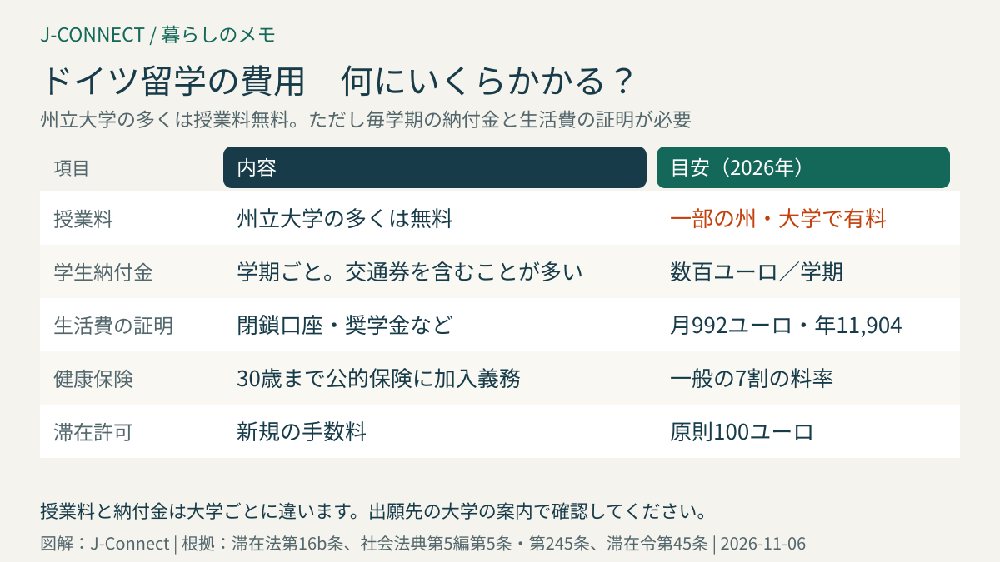
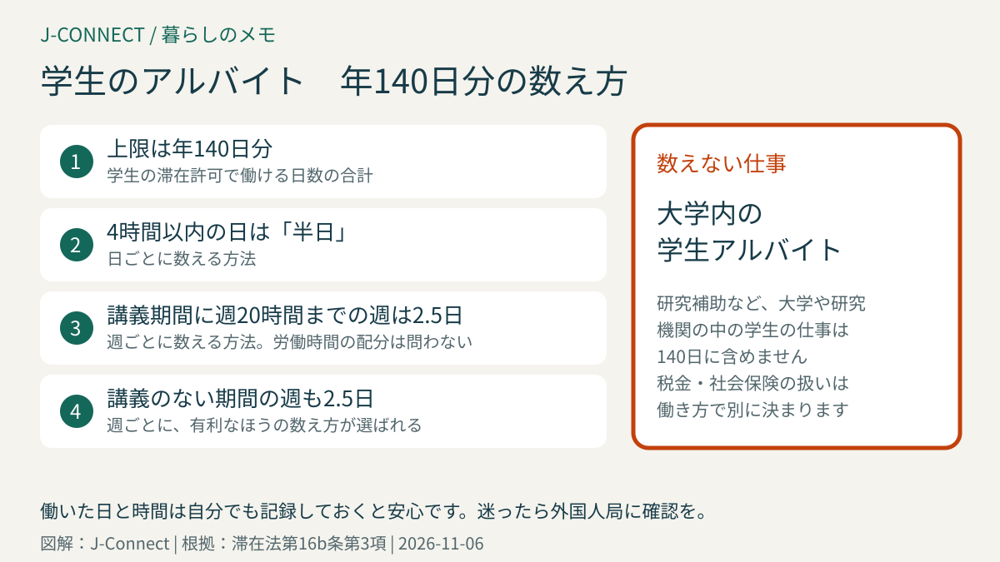

# ドイツの大学に留学する｜学費、入学資格、生活費の証明（月992ユーロ）、学生の滞在許可、働ける日数、卒業後の就職

ドイツは、州立大学の多くで授業料がかからず、英語で学べる修士課程も多いため、日本からの留学先として人気があります。一方で、入学資格の確認、生活費の証明、滞在許可、健康保険など、日本の大学に入るのとは違う準備が必要です。この記事は、ドイツの大学で学位を取ることを考えている日本人に向けて、費用、出願、滞在許可、在学中のアルバイト、卒業後の就職までを順番に整理します。読み終えると、出願の1年前から何を準備すればよいかが分かります。

## まず結論：ドイツ留学の要点

- **授業料**：州立大学の多くは無料。ただし学期ごとの**学生納付金**（多くは数百ユーロ、地域の交通券を含む）が必要で、一部の州や大学では留学生向けの授業料があります
- **生活費の証明**：2026年の目安は**月992ユーロ、1年で1万1,904ユーロ**。閉鎖口座で示すのが一般的です
- **滞在許可**：日本国籍の人はビザなしで入国して、ドイツ国内で学生の滞在許可を申請できます
- **働ける範囲**：**年140日分**まで。4時間以内の日は半日として数えます。大学内の学生アルバイトは数えません
- **卒業後**：仕事を探すために**最長18か月**の滞在許可を受けられます

## 費用：授業料と学生納付金

ドイツの州立大学の多くは、学部・修士とも授業料がかかりません。ただし、次の費用はかかります。

- **学生納付金（学期ごと）**：学生団体や学生生活の支援、学期ごとの交通券の費用などで、多くの大学で数百ユーロです。交通券には全国で使えるドイツチケットの学生版が含まれる大学もあります。
- **一部の州・大学の授業料**：バーデン＝ヴュルテンベルク州の州立大学では、EU以外の国からの留学生に学期ごとの授業料がかかります。バイエルン州のミュンヘン工科大学なども、EU以外の留学生に授業料を設けています。出願先の大学の案内で必ず確認してください。
- **私立大学**：授業料がかかります。国が認めた大学かどうかも確認します。

## 入学資格と語学の条件

### 日本の学歴で入学できるか

ドイツの大学に入るには、ドイツの大学入学資格（アビトゥア）と同等の学歴が必要です。日本の高校卒業だけでは、学部に直接入学できない場合があり、日本の大学で一定期間学んだ実績や、ドイツの大学進学準備コース（Studienkolleg）の修了を求められることがあります。修士課程は、日本の大学の学士号が出願の基本です。

自分の学歴で入学できるかは、ドイツ学術交流会（DAAD）の入学資格のデータベースや、出願先の大学の留学生窓口で確認できます。多くの大学では、留学生の出願書類の審査を代行する機関（uni-assist）を通して出願します。

### 語学の証明

- **ドイツ語で学ぶ課程**：多くの大学で、ドイツ語の大学入学試験（DSH）や、ドイツ語の能力試験（TestDaF）の一定の点数、またはゲーテ・インスティトゥートのC1・C2の証明などを求められます。
- **英語で学ぶ課程**：IELTSやTOEFLなどの点数が求められます。英語の課程でも、生活のためにドイツ語を学ぶことが勧められます。

語学の条件を満たしていない場合、大学の入学許可に「語学コースを修了すること」という条件がつくことがあります。その場合の語学コースも、学生の滞在許可の範囲に含まれます（滞在法第16b条第1項）。

## 生活費の証明と閉鎖口座

学生の滞在許可を受けるには、生活費を自分で払えることを示す必要があります。2026年の目安は**月992ユーロ、1年で1万1,904ユーロ**です。この金額は、国の奨学金（BAföG）の最高額に合わせて決められていて、見直されることがあります。

証明の方法は、一般的に次のどれかです。

- **閉鎖口座（Sperrkonto）**：ドイツの専門の金融機関に1年分を入金し、毎月決まった額だけ引き出せる口座。日本から開設できるサービスが多くあります。
- **奨学金の証明**：日本やドイツの奨学金の受給証明
- **保証の申告書**：ドイツに住む人などが生活費を保証する書類

閉鎖口座の開設には手数料がかかり、入金から開設の証明が出るまで時間がかかることもあります。出願の結果が出たら、すぐに手続きを始めましょう。

## 学生の滞在許可を申請する

日本国籍の人は、ビザなしでドイツに入国し、入国から90日以内に住所地の外国人局で学生の滞在許可を申請できます（滞在令第41条）。必要書類は、一般的に次のとおりです。

- パスポート、生体認証用の写真、申請書
- 大学の入学許可（または入学手続きの証明）
- 生活費の証明（閉鎖口座の証明など）
- 健康保険の加入証明
- 住民登録の証明

滞在許可は、原則として**2年ごと**に出され、最初でも1年を下回らないとされています（滞在法第16b条第2項）。手数料は新規で原則100ユーロです（滞在令第45条）。延長のときは、成績証明などで学業が順調に進んでいることを示します。

まだ入学許可がない人は、出願の準備のための滞在許可（最長9か月、週20時間まで就労可）を使える場合があります（滞在法第17条第2項）。

## 学生の健康保険

ドイツの大学に在籍する学生は、原則として**30歳になるまで公的健康保険の加入義務**があります（社会法典第5編第5条第1項第9号）。保険料率は一般の7割で（同第245条）、介護保険と合わせて月百数十ユーロ程度です。

30歳以上の人や、語学コースや進学準備コースの間は、民間の保険に入るのが一般的です。入学の手続きでは、健康保険の加入証明（または加入義務の免除の証明）を大学に提出します。保険の選び方は[ドイツの健康保険](/germany/ja/living/health-insurance-guide/)で説明しています。

## 在学中のアルバイト：年140日分の数え方

学生の滞在許可で働けるのは、**年140日分**までです（滞在法第16b条第3項）。この日数は、働き方によって次のどちらか有利なほうで数えます。

1. **日ごとに数える**：その日の労働時間が4時間以内なら半日、それより長ければ1日として数えます。
2. **週ごとに数える**：講義期間中に週20時間まで働く週と、講義のない期間に働く週は、労働時間に関係なく**2.5日**として数えます。

どちらで数えるかは、週ごとに有利なほうが選ばれます。また、大学や研究機関の中での**学生アルバイト（研究補助など）は数えません**。

働き方によっては、税金や社会保険の扱いも変わります。講義期間中に週20時間までの「学生の働き方」なら健康保険などの扱いが優遇される一方、ミニジョブの上限を超えると所得税がかかることもあります。[ミニジョブの上限額](/germany/ja/living/minijob-grenze-2027/)も参考にしてください。

## 卒業後に就職する

ドイツの大学を卒業した人は、仕事を探すための滞在許可を**最長18か月**受けられます（滞在法第20条）。この間は、仕事の種類や時間に制限なく働けます。

仕事が見つかったら、専門人材の滞在許可や[EUブルーカード](/germany/ja/living/eu-blue-card-germany/)に切り替えます。ドイツの大学を卒業した人は、永住許可までの期間が短くなる特例もあります（[ドイツの永住許可](/germany/ja/living/permanent-residence-germany/)）。

## 出願から入学までのスケジュールの目安

1. **1年〜1年半前**：志望する課程と入学資格、語学の条件を調べる。語学試験の準備を始める
2. **半年〜1年前**：語学試験を受ける。書類を翻訳・認証する
3. **出願期間**：冬学期（10月開始）は多くの大学で7月15日ごろまで、夏学期（4月開始）は1月15日ごろまでが一般的です。留学生は締め切りが早い場合もあります
4. **入学許可の後**：閉鎖口座、健康保険、住まいを準備する
5. **入国後**：住民登録、大学の入学手続き、滞在許可の申請

住まいは学生寮が人気で、申し込みが早いほど入りやすくなります。[ドイツの賃貸・家探し](/germany/ja/living/rent-apartment-germany/)で、詐欺の手口も確認しておきましょう。

## よくある質問

### 語学学校に通ってから大学に出願できますか？

できます。語学コースの滞在許可（滞在法第16f条）で入国し、ドイツ語を学んでから大学に出願する人もいます。ただし、語学コースの許可では週20時間までしか働けないなど、学生の許可と条件が異なります。

### 交換留学でも同じ手続きですか？

日本の大学との協定による交換留学でも、滞在が3か月を超える場合は学生の滞在許可が必要です。大学の国際交流の窓口が、受け入れ証明などの書類を案内してくれます。

### 家族と一緒に留学できますか？

学生の配偶者や子どもも、家族の呼び寄せの滞在許可を受けられる場合があります。家族の分の生活費の証明も必要です。[家族をドイツに呼び寄せるとき](/germany/ja/living/family-reunification-spouse-work-germany/)を参考にしてください。

## 関連記事

- [ドイツのビザ・滞在許可の種類](/germany/ja/living/germany-visa-types-japanese/)
- [ドイツの健康保険](/germany/ja/living/health-insurance-guide/)
- [ドイツの銀行口座開設](/germany/ja/living/bank-account-germany/)
- [ミニジョブの上限額](/germany/ja/living/minijob-grenze-2027/)
- [ドイツの賃貸・家探し](/germany/ja/living/rent-apartment-germany/)

## 公式情報・参考ソース

- [滞在法第16b条：大学での留学（働ける日数を含む）](https://www.gesetze-im-internet.de/aufenthg_2004/__16b.html)
- [滞在法第17条：大学の出願準備のための滞在](https://www.gesetze-im-internet.de/aufenthg_2004/__17.html)
- [滞在法第20条：卒業後の求職](https://www.gesetze-im-internet.de/aufenthg_2004/__20.html)
- [滞在令第41条：日本国籍者などのビザなし入国](https://www.gesetze-im-internet.de/aufenthv/__41.html)
- [社会法典第5編第5条：学生の健康保険の加入義務](https://www.gesetze-im-internet.de/sgb_5/__5.html)
- [社会法典第5編第245条：学生の保険料率](https://www.gesetze-im-internet.de/sgb_5/__245.html)
- [滞在令第45条：滞在許可の手数料](https://www.gesetze-im-internet.de/aufenthv/__45.html)

**参照日：2026年11月6日。** 生活費の証明の金額や大学の授業料は、毎年見直されることがあります。この記事は一般的な情報で、個別の助言ではありません。出願前に必ず志望する大学、外国人局、ドイツ大使館の最新の案内を確認してください。
