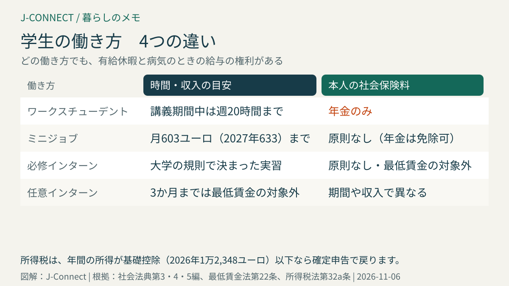
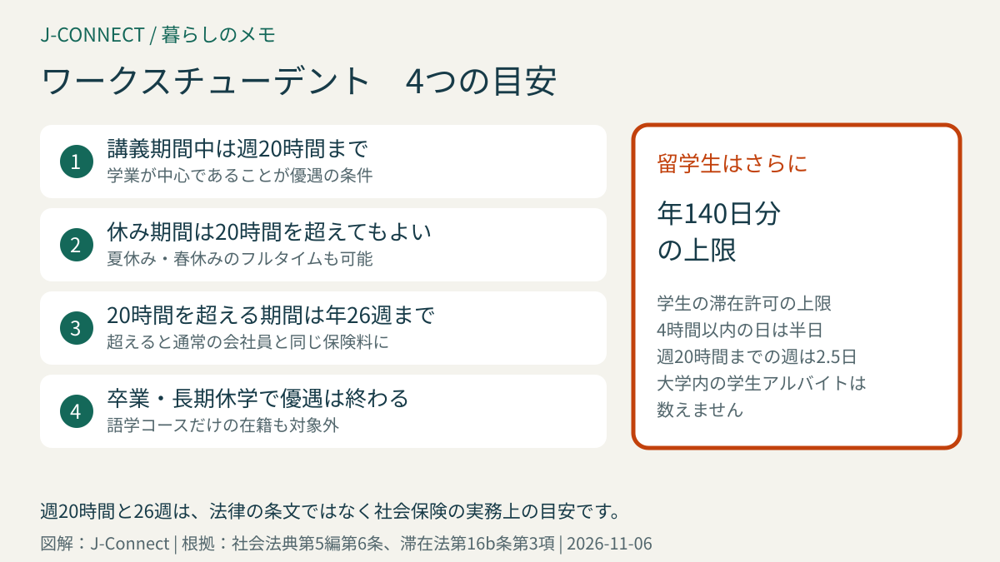

# ドイツの学生の働き方｜ワークスチューデント・ミニジョブ・インターンの違い、週20時間の目安、社会保険と税金、留学生の日数の上限

ドイツの大学生の多くは、学びながら働いています。特に、専攻に関わる仕事を会社で続ける「ワークスチューデント（Werkstudent）」は、収入と職務経験の両方が得られ、卒業後の就職にもつながる働き方として人気があります。この記事は、ドイツの大学で学ぶ日本人や、ドイツで学ぶ子どもを持つ家庭に向けて、学生の主な働き方の違い、社会保険と税金の扱い、留学生の働ける日数の上限を整理します。読み終えると、自分に合った働き方と、働きすぎて損をしないための目安が分かります。

## まず結論：学生の4つの働き方

| 働き方 | 主な特徴 | 社会保険 | 向いている人 |
| --- | --- | --- | --- |
| ワークスチューデント | 講義期間中は週20時間までが目安 | 年金の保険料のみ | 専攻に関わる経験を積みたい |
| ミニジョブ | 月603ユーロ（2027年は633ユーロ）まで | 原則として本人の負担なし（年金は免除の申請可） | 短時間だけ働きたい |
| 必修のインターン | 大学の規則で決まった実習 | 原則として保険料なし | 学位に実習が必要 |
| 任意のインターン | 自分で選ぶ実習 | 期間や収入で異なる | 業界を知りたい |

どの働き方でも、雇用契約、有給休暇、病気のときの給与の権利があります。契約の基本は[ドイツの労働契約で確認したいこと](/germany/ja/living/employment-contract-germany/)にまとめています。

## ワークスチューデント

### どんな働き方か

大学に正規の学生として在籍している人が、会社で働く形です。法律上の特別な雇用形態ではなく、社会保険の扱いが優遇される学生の働き方を指します。IT、エンジニアリング、マーケティング、研究開発など、専攻に関わる仕事が多く、卒業後にそのまま正社員になる人もいます。

### 社会保険の扱い

ワークスチューデントは、**健康保険・介護保険・失業保険の保険料がかからず**（社会法典第5編第6条第1項第3号、第3編第27条第4項）、**年金の保険料だけ**を払います。手取りが多くなるのが大きな利点です。

この優遇を受けるには、学業が中心で、仕事は副次的であることが必要です。社会保険の実務では、次の目安が使われています。

- **講義期間中は週20時間まで**
- 講義のない期間（夏休み・春休み）は、週20時間を超えて働いてもよい
- ただし、週20時間を超えて働く期間は、1年に**26週まで**

この目安を超えると、通常の会社員と同じように、すべての社会保険の保険料がかかります。学生の健康保険にも入っている人は、加入先が変わる場合があります。働く時間を増やす前に、会社の人事担当と健康保険に確認してください。

### 対象にならない人

- 語学コースや大学進学準備コースだけに通っている人
- 卒業した後（最後の試験の結果が出た月の終わりなど）
- 長期の休学中の人

## ミニジョブ

月の収入が上限以下の働き方です。上限は最低賃金に連動して決まり、**2026年は月603ユーロ、2027年は月633ユーロ**です（社会法典第4編第8条）。

- 本人は、原則として健康保険や失業保険の保険料を払いません。年金の保険料はかかりますが、免除を申請できます。
- 会社が一律の税金を払う形にすれば、本人に所得税はかかりません。
- ミニジョブを複数かけ持ちすると、合計で上限を超える場合があります。

詳しくは[ミニジョブの上限額](/germany/ja/living/minijob-grenze-2027/)で説明しています。

### 月603ユーロを超え、2,000ユーロまでのとき

月の収入が上限を超え、2,000ユーロまでの範囲は「移行ゾーン（Übergangsbereich）」と呼ばれ、本人の社会保険料が少なめに計算されます（社会法典第4編第20条）。ワークスチューデントがこの範囲で働く場合も、年金の保険料が少なくなります。

## インターン

### 最低賃金の扱い

インターンにも原則として最低賃金が適用されますが、次の場合は対象外です（最低賃金法第22条）。

- 学校や大学の規則で決まった**必修のインターン**
- 学業と並行して行う**3か月まで**の任意のインターン（同じ会社で以前にインターンをしていない場合）
- 進路を決めるための**3か月まで**のインターン

例外に当たらない任意のインターンには、原則として初日から最低賃金が適用されます。時給は2026年が13.90ユーロ、2027年1月1日から14.60ユーロです。ワークスチューデントやミニジョブなど、雇用されて働く学生も原則として対象です。対象者と例外の条件は[連邦労働社会省の最低賃金案内](https://www.bmas.de/DE/Arbeit/Arbeitsrecht/Mindestlohn/Informationen-zum-Mindestlohn/informationen-zum-mindestlohn-deutsch.html)と最低賃金法第22条で確認してください。労働契約や給与明細の見方は[ドイツの労働契約](/germany/ja/living/employment-contract-germany/)も参考になります。

### 社会保険の扱い

必修のインターンは、原則として保険料がかかりません。任意のインターンは、期間や収入、講義期間中かどうかで扱いが変わり、ワークスチューデントやミニジョブと同じように扱われることが多くあります。

## 税金：基礎控除の範囲なら戻ってくる

所得税は、1年間の所得が**基礎控除（2026年は1万2,348ユーロ）**以下ならかかりません（所得税法第32a条）。ワークスチューデントの給与から毎月所得税が差し引かれていても、年間の所得が少なければ、翌年の確定申告で戻ってきます。

- 給与から税金を差し引くには、税番号と税区分が必要です。多くの学生は税区分「1」です。[税番号と税区分](/germany/ja/living/tax-id-steuernummer-steuerklasse/)を参考にしてください。
- 学生は、学費、教材、通学の費用などを、条件によって経費として申告できます。
- 確定申告の流れは[ドイツの確定申告](/germany/ja/living/income-tax-return-germany/)で説明しています。

## 日本人留学生の働ける日数

日本国籍の留学生は、社会保険の目安とは別に、**滞在許可の上限**も守る必要があります。学生の滞在許可で働けるのは**年140日分**までで、4時間以内の日は半日として数えます。講義期間中に週20時間まで働く週は2.5日として数えるなど、有利な数え方が選べます（滞在法第16b条第3項）。大学や研究機関の中での学生アルバイトは、この日数に含めません。

ワークスチューデントとして週20時間働くと、1年で140日分を使い切ることもあります。数え方は[ドイツの大学に留学する](/germany/ja/living/study-in-germany-student-visa/)で詳しく説明しています。上限を超えて働くと滞在許可に影響するおそれがあるので、働いた日と時間を記録しておきましょう。

## 仕事の探し方

- **大学のキャリアセンターや掲示板**：地元の会社のワークスチューデントの募集が集まります。
- **求人サイト**：「Werkstudent」と専攻の分野で検索すると多くの募集が見つかります。
- **大学の研究室**：研究補助の学生アルバイトは、留学生の日数に数えないため人気があります。
- **日系企業**：日本語を生かせる仕事もあります。J-Connectの[求人ページ](/germany/ja/jobs/)も参考にしてください。

応募には、ドイツ式の履歴書と、在学証明書、成績証明書を用意します。会社は、学生であることを確認するため、学期ごとに在学証明書の提出を求めます。

## よくある質問

### 夏休みだけフルタイムで働けますか？

講義のない期間は、週20時間を超えて働いてもワークスチューデントとして扱われるのが一般的です。ただし、1年に26週を超えないように注意します。留学生は、滞在許可の日数の上限にも数えられます。

### 修士課程の入学待ちの間も、ワークスチューデントで働けますか？

学士課程を終えて、修士課程に入るまでの間は、学生の身分がない期間として扱われることがあります。社会保険の扱いが変わるので、会社と健康保険に確認してください。

### 30歳を過ぎた学生も同じですか？

ワークスチューデントの社会保険の優遇は、年齢にかかわらず使えます。ただし、30歳を過ぎると学生の公的健康保険に入れなくなる場合があり、自分で保険を選ぶ必要が出てきます。

## 関連記事

- [ドイツの大学に留学する](/germany/ja/living/study-in-germany-student-visa/)
- [ミニジョブの上限額](/germany/ja/living/minijob-grenze-2027/)
- [ドイツの労働契約で確認したいこと](/germany/ja/living/employment-contract-germany/)
- [税番号と税区分](/germany/ja/living/tax-id-steuernummer-steuerklasse/)
- [ドイツの確定申告](/germany/ja/living/income-tax-return-germany/)

## 公式情報・参考ソース

- [社会法典第5編第6条：学生の健康保険の加入義務の免除](https://www.gesetze-im-internet.de/sgb_5/__6.html)
- [社会法典第3編第27条：学生の失業保険の免除](https://www.gesetze-im-internet.de/sgb_3/__27.html)
- [社会法典第4編第8条：ミニジョブ](https://www.gesetze-im-internet.de/sgb_4/__8.html)
- [社会法典第4編第20条：収入の移行ゾーン](https://www.gesetze-im-internet.de/sgb_4/__20.html)
- [所得税法第32a条：所得税の税率と基礎控除](https://www.gesetze-im-internet.de/estg/__32a.html)
- [最低賃金法第22条：インターンへの最低賃金の適用](https://www.gesetze-im-internet.de/milog/__22.html)
- [滞在法第16b条：留学生の働ける日数](https://www.gesetze-im-internet.de/aufenthg_2004/__16b.html)

**参照日：2026年11月6日。** 週20時間や26週の目安は、法律の条文ではなく社会保険の実務上の基準です。個別の扱いは、会社の人事担当、健康保険、年金保険に確認してください。この記事は一般的な情報で、個別の助言ではありません。
