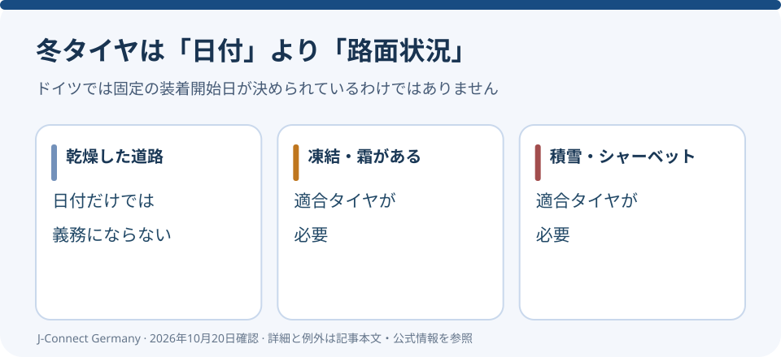
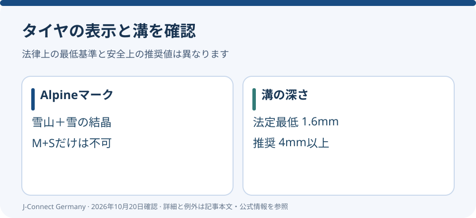

# ドイツの冬タイヤ義務2026｜交換時期・雪マーク・オールシーズンタイヤ

ドイツで車を運転する人にとって、秋のうちに確認したいのが冬タイヤです。日本と違い「何月何日から装着」と全国一律に決められているわけではなく、実際の路面状況によって必要になります。この記事では2026年11月20日時点の法令と、2026年10月8日更新のADAC、11月19日更新のドイツ保険協会の案内をもとに、手持ちのタイヤが使えるか、例外規定、違反時の点数、レンタカーと事故時の保険を整理します。

## 結論：10月だから義務、ではない

ドイツの道路交通規則第2条3a項は、凍結、雪による滑りやすさ、シャーベット状の雪、氷、霜による滑りやすさがあるとき、原則として所定の冬季対応タイヤを使うことを求めています。一般の乗用車では**四輪すべて**が対象です。

「10月からイースターまで」を意味する **O bis O** は、交換を忘れないための目安であり、法律上の期間ではありません。10月の暖かい日には冬タイヤ装着が一律の義務になるわけではありませんが、11月前でも路面が凍れば規則が適用されます。

| よくある状況 | どう判断するか |
| --- | --- |
| 10月の乾いた道路 | 日付だけでは冬タイヤ義務は発生しない |
| 朝の橋や日陰で路面が凍っている | 冬季対応タイヤが必要 |
| 雪やシャーベット状の雪が残る道路 | 冬季対応タイヤが必要 |
| 車を使わず公共交通機関に切り替える | 不適合タイヤで冬季路面を走ることを避けられる |

## タイヤ側面の「山と雪の結晶」を確認

2026年に最初に確認すべきなのは、タイヤ側面の**山の中に雪の結晶が描かれたAlpineマーク（3PMSF）**です。法律が冬季対応タイヤとして求めるのは、この表示を備えたタイヤです。

以前のタイヤには「M+S」（泥と雪）とだけ書かれたものがあります。旧タイヤ向けの移行措置は**2024年9月30日で終了**しました。したがって、2026年の冬に「M+S」としか書かれていないタイヤで凍結・積雪路面を走るのは、規則を満たしません。「M+S」も併記されていて、Alpineマークがあるなら、表示だけを理由に不適合とはなりません。

### オールシーズンタイヤでもよい？

はい。**オールシーズンタイヤでもAlpineマークがあれば**、冬季対応タイヤとしての表示要件を満たします。ただし「法律上使える」ことと「雪道で十分に性能を発揮する」ことは別です。雪が多い地域や山道を頻繁に走る場合は、タイヤの性能試験や用途を確認し、専用冬タイヤも検討してください。

車を購入したばかりの人は、販売時の説明が「Allwetterreifen（全天候タイヤ）」だったというだけで安心せず、**実際の四輪の表示**を目で確認します。

## 溝の深さは1.6ミリが法定最低、4ミリは安全上の推奨

ドイツの車両登録規則第36条では、通常の乗用車タイヤの主要な溝に**最低1.6ミリ**の深さが必要です。一方、ADACは冬季の安全余裕を考え、**4ミリ以上**を推奨しています。この二つを混同しないでください。4ミリは一般の乗用車についての法定最低値ではありません。

溝が残っていても、古いタイヤではゴムの硬化や傷みが問題になることがあります。タイヤ側面のDOT製造時期、ひび割れ、偏った摩耗、空気圧も確認し、状態が不明なら整備工場で点検を依頼します。購入時は車の指定サイズ・荷重指数・速度記号にも適合させます。

## 違反したらどうなる？事故時の保険も確認

過料規則の付表では、冬季路面で不適合タイヤを使った運転者は通常**60ユーロ**、その違反で他者を妨げた場合は**80ユーロ**です。車両保有者が不適合タイヤの車両を使用させた場合は**75ユーロ**です。運転免許規則の付表13では、運転者の違反（BKat 5a・5a.1）だけでなく、車両保有者の違反（BKat 213a）も**各1点**の対象です。点数は運転者の違反と保有者の違反で別の区分に記載されています。金額と点数は2026年11月20日に現行の法令で確認しました。

| 対象 | 違反の状況 | 法令上の反則金・点数 |
| --- | --- | ---: |
| 運転者 | 冬季路面で不適合タイヤを使用 | 60ユーロ・1点 |
| 運転者 | その違反で他者を妨害 | 80ユーロ・1点 |
| 車両保有者 | 不適合タイヤの車両を使用させた場合 | 75ユーロ・1点 |

### 例外と大型車の特則

道路交通規則第2条3a項は、通常の冬季タイヤ義務が適用されない車両を限定して列挙しています。

- 農林業用の作業車
- 車輪が前後一列に並ぶ自動車（例：オートバイ）
- フォークリフト
- 法令上の要件を満たす電動車いす
- 法律で指定された組織の緊急車両のうち、車両の構造上、冬季対応タイヤを入手できないもの
- 車両の構造上、タイヤ分類C1・C2・C3の適合タイヤを入手できない特殊車両

これは一般の乗用車向けの免除ではありません。普通乗用車は原則どおり四輪すべてに適合タイヤが必要です。

また、大型バス・トラックに当たる車両分類M2・M3・N2・N3には別の特則があり、恒常的に駆動する車軸と前方の操舵車軸に適合タイヤを装着していれば、冬季路面で走行できる場合があります。普通乗用車のルールと混同しないでください。

法令上、適合タイヤを装着せずに走行が認められる車両では、運転者に追加条件があります。毎回の出発前に、目的地へ他の交通手段で行けないため本当に走行が必要かを確認し、走行中は速度計の数値の半分以上（km/hに対するメートル）の車間距離を保ち、50km/hを超えないことが求められます。より低い速度が必要な状況では、当然そちらを優先します。

トレーラー自体にはこの冬タイヤ義務は適用されませんが、牽引時の安定性を考え、ADACは適切なタイヤを推奨しています。

事故時の保険は、対人・対物の賠償責任保険と、自分の車を補償する車両保険を分けて考えます。ドイツ保険協会（GDV）は2026年11月19日更新の案内で、事故の責任を負う運転者が不適合タイヤを使っていても、賠償責任保険は被害者の損害を補償すると説明しています。一方、車両保険は、重大な過失が事故の原因になった場合に保険金を減額することがあります。また、自分に事故の責任がない場合でも、個別事情によって過失の一部を負担する可能性があります。すべての事故で保険が無効になるという意味ではありません。

## 自分の車・社用車・レンタカーで確認すること

**自家用車：** タイヤ四輪のAlpineマーク、溝の深さ、傷みを確認します。交換が必要なら初霜の前に整備工場の予約を取り、保管場所や費用も確認します。

**社用車・リース車：** 誰が交換を手配するか、承認済みの工場はどこか、交換費用と保管費用の扱いを会社・リース契約で確認します。「会社の車だから運転者は無関係」とは考えず、運転前に車両の状態を確かめます。

**レンタカー：** 予約画面の「冬季装備」の有無だけでなく、引渡し時に四輪のタイヤ表示を確認し、必要なら写真を残します。ADACは、冬季路面で夏タイヤを装着した車両は安全に走れる状態ではなく、借主は引き渡しを拒否できると説明しています。冬タイヤが追加料金扱いになる場合もあるため、予約前に料金と装着条件を確認してください。

## NRWの都市部でも注意したい場面

デュッセルドルフやケルンの市街地は山間部より積雪が少ない日もありますが、**橋、日陰、早朝の郊外道路**では路面状況が変わります。出発時に乾いていても帰宅時に凍る可能性があるため、通勤や夜間の運転を予定している人は早めの交換が現実的です。道路の状態が不明で適合タイヤがない場合は、運転を見合わせる判断も必要です。

ドイツ国外へ車で行く場合、オーストリア、フランス、イタリアなどは地域や道路標識によって条件が異なります。**ドイツで合法だから隣国でも必ず合法**とは限りません。出発先・通過国の最新規則を確認してください。

## 出発前の30秒チェック

- 四輪にAlpineマークがあるか。
- 溝の深さ、傷、空気圧に問題がないか。
- 今日の道路に凍結・積雪・霜がないか。
- 山道や国境越えでは、現地の追加ルールを調べたか。
- 不適合なら運転せず、交換・代替交通手段を選べるか。

ドイツの冬タイヤ規則の核心は、**日付ではなく路面状況、M+SだけではなくAlpineマーク**という二点です。安全上の推奨と法的義務を区別し、初めての冬を迎える前にタイヤの現物を確認してください。

## 公式情報・確認先

- [道路交通規則第2条3a項（冬季路面での運転）](https://www.gesetze-im-internet.de/stvo_2013/__2.html)
- [車両登録規則第36条（冬タイヤの定義・溝の深さ）](https://www.gesetze-im-internet.de/stvzo_2012/__36.html)
- [道路交通規則第52条（M+Sタイヤの移行措置は2024年9月30日まで）](https://www.gesetze-im-internet.de/stvo_2013/__52.html)
- [過料規則（BKatV）付表：運転者60ユーロ・80ユーロ、車両保有者75ユーロ](https://www.gesetze-im-internet.de/bkatv_2013/anlage.html)（2026年11月20日確認）
- [運転免許規則（FeV）付表13：冬タイヤ違反の点数](https://www.gesetze-im-internet.de/fev_2010/anlage_13.html)（2026年11月20日確認）
- [ADAC：ドイツの冬タイヤ義務（2026年10月8日更新）](https://www.adac.de/rund-ums-fahrzeug/ausstattung-technik-zubehoer/reifen/sicherheit/winterreifenpflicht-deutschland/)
- [ADAC：オールシーズンタイヤの冬季利用](https://www.adac.de/rund-ums-fahrzeug/ausstattung-technik-zubehoer/reifen/sicherheit/ganzjahresreifen-im-winter/)
- [GDV：冬タイヤ未装着と保険の扱い（2026年11月19日更新）](https://www.gdv.de/gdv/medien/medieninformationen/winterreifen-wer-bei-schnee-und-eis-mit-sommerreifen-faehrt-riskiert-seinen-versicherungsschutz-219808)

**参照日：2026年11月20日。** 本記事は一般的な乗用車の利用者向けです。例外車両や大型車には別条件があり、個別の事故・保険・行政処分については専門家または当局へ確認してください。
