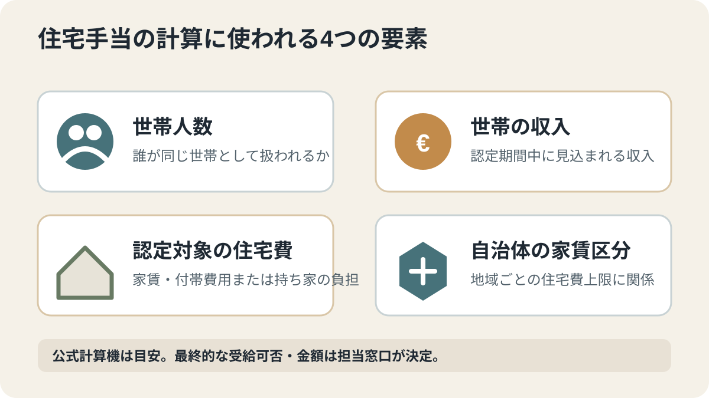
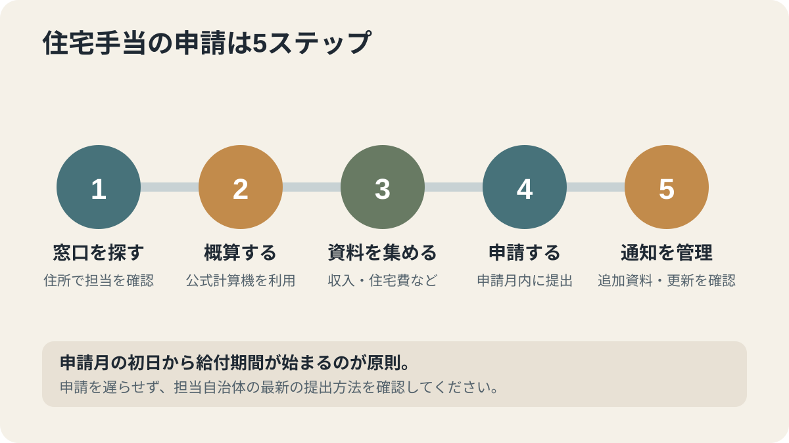

# ドイツの住宅手当（Wohngeld）とは？対象・申請方法・必要書類【2026年】

ドイツの住宅手当（Wohngeld）は、家賃や自己所有住宅の費用負担が重い低所得世帯を支える現金給付です。賃貸住宅に住む人は家賃補助、自己所有の住宅に住む人は住宅費補助を申請できます。対象になるかは収入だけでなく、世帯人数、認定される住宅費、自治体の家賃区分で決まるため、計算の見方と申請手順を分けて説明します。

## 先に結論

- 住宅手当は自動では支給されず、住んでいる住宅の所在地を担当する窓口への申請が必要です。
- 賃貸住宅向けの「Mietzuschuss」と、自己所有住宅向けの「Lastenzuschuss」があります。
- 受給可否と金額は、世帯人数、世帯の収入、認定対象となる家賃・住宅費、自治体の家賃区分で決まります。全国一律の単純な所得上限はありません。
- 住宅費がすでに別の社会給付に含まれている場合は、原則として対象外になることがあります。求職者向け基礎保障や社会扶助との違いを確認してください。

## 住宅手当は何を支える制度？

住宅手当は、生活費全体を補う制度ではなく、住居費の負担を軽くするための給付です。連邦住宅省は、基礎保障を受けるほどではないものの、収入に比べて住宅費が重い世帯を主な対象として説明しています。

| 住まいの形 | 申請する給付 | 対象 |
| --- | --- | --- |
| 賃貸住宅・サブレット | 家賃補助（Mietzuschuss） | 家賃など、法律上認められる住宅費 |
| 自己所有の住宅 | 住宅費補助（Lastenzuschuss） | 住宅ローンの利息・返済、維持費など、法律上認められる負担 |

持ち家でも、自己居住している住宅であれば対象になる場合があります。投資用物件や賃貸に出している物件の住宅費を補う制度ではありません。

## どのような人が対象になりやすい？

連邦住宅省が例として挙げているのは、次のような世帯です。

- 収入が低い会社員やパート勤務者
- 年金額が低く、住居費の負担が重い人
- 低所得の子育て世帯、ひとり親、共働き世帯
- 原則としてBAföG（連邦教育奨学金）の対象とならない課程で学ぶ学生など
- 一定の条件を満たす介護施設の入居者

ただし、これらは確認を始める目安であり、該当すれば必ず受給できるという意味ではありません。収入と住宅費の両方を確認する必要があります。

### 住宅手当を受けられないことがある場合

住宅費がすでに別の社会給付に含まれている場合、同じ世帯・同じ必要に対して住宅手当を重ねて受け取ることは原則としてできません。住宅手当法第7条は、たとえば次の給付を受けている人を対象外としています。

- 求職者向け基礎保障（Grundsicherungsgeld）
- 高齢・就労不能者向けの基礎保障
- 生活費扶助などの社会扶助
- 亡命申請者向けの給付で、住宅費が計算に含まれている場合

ただし、法律には例外があります。住宅手当によって困窮状態を避けられる場合など、他の給付との調整が必要になることもあります。給付を受けているからといって自己判断で申請をあきらめず、担当窓口に世帯全体の状況を説明してください。

## 金額は何で決まる？

住宅手当の金額は、主に次の4つで決まります。

1. **世帯人数：** 同じ収入と家賃でも、対象となる世帯人数によって計算が変わります。
2. **世帯の収入：** 申請時点の一時的な収入だけでなく、通常は認定期間中に見込まれる収入が確認されます。
3. **認定対象となる住宅費：** 実際に支払っている家賃や住宅ローンの負担が、そのまま全額認められるとは限りません。
4. **自治体の家賃区分：** 市町村ごとの家賃水準を示す区分により、計算に含められる住宅費の上限が異なります。

そのため、「月収が何ユーロ以下なら受け取れる」という全国共通の一つの数字はありません。インターネット上の古い所得基準表だけで判断せず、世帯人数・住所・収入・住宅費を使って確認してください。

### 賃貸住宅の人が計算機に入力する家賃

連邦住宅省の計算機では、賃貸住宅の場合、基本的に「Bruttokaltmiete（冷家賃と冷たい付帯費用を合わせた額）」を入力します。

含まれる例：
- 基本家賃
- 水道使用料
- 道路清掃・ごみ処理費などの冷たい付帯費用

通常この入力に含めない例：
- 暖房費、温水費
- ガレージ・駐車場の料金
- 家賃以外の一般的な介護・生活支援サービス料金

持ち家の場合は、住宅ローンの利息・返済、維持管理費、固定資産税など、別の項目で住宅費負担を入力します。入力欄の説明を読み、賃貸用の家賃と持ち家用の負担を混ぜないでください。

## 公式計算機で概算する

連邦住宅省の「Wohngeld-Plus計算機」は、受給できる可能性や金額を確認するための無料ツールです。郵便番号から自治体と家賃区分を選び、世帯人数、住宅費、収入などを入力します。

計算機のページは「2025年1月1日版」と表示されています。2026年11月4日時点で、連邦政府が案内する公式計算機として確認できるものですが、結果はあくまで最初の目安です。計算機の結果だけで受給が決まるわけではなく、法的に有効な判断は担当の住宅手当窓口が行います。

計算結果を保存し、入力した収入・家賃・世帯人数が現在の状況に合っているか確認してから申請してください。

## どこに申請する？

外国籍の人は、在留資格や他の社会給付との関係によって扱いが変わることがあります。対象になるか迷う場合は、滞在許可の種類と世帯状況を担当窓口に伝えて確認してください。

申請先は、住んでいる住宅の所在地を担当する住宅手当窓口です。市、郡、郡独立市などの自治体が担当します。ジョブセンターや外国人局に申請する制度ではありません。

申請方法は自治体によって異なります。連邦住宅省によると、多くの州・自治体ではオンライン申請が利用できますが、紙の申請書を郵送・窓口提出する地域もあります。

1. 連邦行政ポータルで「Wohngeld」を検索し、住所を担当する窓口を確認する。ポータルの申請案内は州ごとに異なるため、表示された地域の説明を確認する。
2. その自治体の公式ページでオンライン申請の有無と申請書を確認する。
3. 申請フォームと必要書類をまとめて提出する。
4. 受付確認や追加資料の依頼を保管し、期限内に対応する。
5. 決定通知に書かれた給付期間と金額を確認する。

### デュッセルドルフの例

デュッセルドルフ市は、2026年5月28日の案内で、住宅手当のオンライン申請を受け付けていると説明しています。さらに2026年6月1日からは、デジタル手続きを利用しない人向けに、市内の複数の窓口で申請書を入手できるようにしました。

これはデュッセルドルフの例です。ほかの市や郡では申請方法や書類の配布場所が異なるため、必ず自分の住所を担当する自治体の案内を確認してください。

## 必要書類のチェックリスト

自治体や世帯の状況によって異なりますが、一般的には次の資料が求められます。

- 住宅手当の申請書
- パスポートや身分証明書、必要に応じて滞在許可
- 賃貸契約書、現在の家賃・付帯費用が分かる資料
- 世帯全員の収入証明（給与明細、年金通知、給付通知など）
- 持ち家の場合は住宅ローンや維持費などの負担を示す資料
- 世帯構成を確認できる資料
- 振込先口座情報
- 自治体から個別に求められた追加資料

連邦住宅省のFAQは、住宅費の証明と世帯員の総収入の証明を主要な資料として挙げています。収入や世帯構成に変更がある場合は、説明できる資料を追加してください。

## いつから支給される？

住宅手当は自動的に始まるものではなく、申請が必要です。住宅手当法第25条では、原則として申請を提出した月の初日から給付期間が始まります。月の途中で申請しても、受給条件を満たせば、その月の1日からの計算になります。

通常の給付期間は12か月です。見込まれる収入や住宅費などの状況が安定している場合は、最長24か月まで認められることがあります。給付期間の終わりが近づいたら、次の期間の申請時期を自治体に確認してください。

審査が長引いている場合、連邦住宅省のFAQは、受給可能性が高く決定まで時間がかかると見込まれるケースについて、住宅手当法第26a条に基づく暫定支給を申請できると案内しています。これは自動支給ではなく、担当窓口が条件を確認して判断します。自動的に支給されるものではないため、該当しそうな場合は担当窓口に相談してください。

## 受給中に収入や家賃が変わったら？

受給期間中に世帯人数、家賃、収入が変わると、支給額の再計算や届出が必要になる場合があります。

- 家賃や住宅費が大きく上がった
- 世帯の収入が大きく下がった
- 家族が転入・転出した
- 就職、転職、退職、年金受給などで収入が変わった

住宅手当法第27条には、家賃・住宅費の増加や総収入の減少によって給付が増える場合に、申請して再決定を求められる条件があります。一方、収入増加や家賃の減少などによって給付が減る場合には、届出義務や再計算が生じることがあります。変化があったら、決定通知と法律の条件を確認し、早めに担当窓口へ連絡してください。

## 2027年の見直し案は現在の申請に適用される？

2026年11月4日時点で報じられている2027年の住宅手当見直しは、法律改正案の段階です。現行制度で申請する人は、成立・施行前の案を現在の計算方法として使わないでください。政府案の内容や今後の審議は、[2027年の住宅手当見直しに関する記事](/germany/ja/events/news/wohngeld-reform-2027/)で別に整理しています。

## よくある質問

### 住宅手当は家賃の全額を払ってくれますか？

いいえ。住宅手当は住宅費の一部を支える給付です。認定対象となる家賃・住宅費には自治体の家賃区分や世帯人数に応じた上限があり、実際の家賃全額が計算に含まれるとは限りません。

### 住宅手当と求職者向け基礎保障を同時に受け取れますか？

同じ世帯員について、住宅費がすでに求職者向け基礎保障などの給付に含まれている場合、原則として住宅手当は対象外になります。ただし、法律には例外や世帯員ごとの調整があります。自分で判断せず、担当窓口に世帯全体の状況を伝えてください。

### 持ち家でも申請できますか？

自己居住している住宅であれば、Lastenzuschuss（住宅費補助）を申請できる場合があります。住宅ローンや維持費など、法律上認められる負担を証明する資料が必要です。

### 申請してから何か月も返事がない場合は？

審査は州や自治体の住宅手当窓口が担当します。連邦住宅省は個別申請の進捗を確認できません。受付番号を用意して担当窓口に問い合わせてください。受給可能性が高く審査に時間がかかる場合は、暫定支給の申請について相談できます。

## 関連記事

- [ドイツの失業手当：受給条件・金額・期間と届け出](/germany/ja/living/unemployment-benefit-germany/)
- [ドイツの住宅手当が2027年に見直しへ](/germany/ja/events/news/wohngeld-reform-2027/)
- [ドイツの住宅手当が2027年に見直しへ](/germany/ja/events/news/wohngeld-reform-2027/)

## 公式情報・参考ソース

- [連邦住宅省：住宅手当のよくある質問](https://www.bmwsb.bund.de/SharedDocs/faqs/DE/buergerkom/wohngeld-plus/wohngeld-FAQ-artikel.html)
- [連邦住宅省：住宅手当計算機（2025年1月1日版）](https://www.bmwsb.bund.de/DE/wohnen/wohngeld/wohngeldrechner/wohngeldrechner-2025_artikel.html)
- [連邦行政ポータル：居住地に応じた行政窓口の検索](https://verwaltung.bund.de/portal/)
- [連邦行政ポータル：住宅手当の申請案内（バイエルン州の地域例。実際の手続きは自治体により異なる）](https://verwaltung.bund.de/leistungsverzeichnis/DE/leistung/99107023037000/herausgeber/BY-24752/region/092725214138)
- [住宅手当法 §3：受給対象者](https://www.gesetze-im-internet.de/wogg/__3.html)
- [住宅手当法 §7：他の給付を受ける場合の除外](https://www.gesetze-im-internet.de/wogg/__7.html)
- [住宅手当法 §22：申請が必要であること](https://www.gesetze-im-internet.de/wogg/__22.html)
- [住宅手当法 §25：給付期間と開始月](https://www.gesetze-im-internet.de/wogg/__25.html)
- [住宅手当法 §27：給付期間中の変更](https://www.gesetze-im-internet.de/wogg/__27.html)
- [住宅手当法 §26a：暫定支給](https://www.gesetze-im-internet.de/wogg/__26a.html)
- [住宅手当法 §26a：暫定支給](https://www.gesetze-im-internet.de/wogg/__26a.html)
- [デュッセルドルフ市：住宅手当のオンライン申請と書類入手先](https://www2.duesseldorf.de/medienportal/pressedienst-einzelansicht/pld/mehr-service-vor-ort-wohnungsamt-erweitert-angebot)
- [ドイツ連邦議会：住宅手当法改正案21/8284の概要（2026年10月5日）](https://www.bundestag.de/presse/hib/kurzmeldungen-1222360)

**確認日：2026年11月4日。** この記事は一般的な申請手順の説明です。実際の受給資格・金額・必要書類は、世帯の状況と担当自治体の審査によって異なります。2027年の改正案は、成立・施行されるまで現行制度として扱いません。専門家レビューが完了するまで公開しません。
