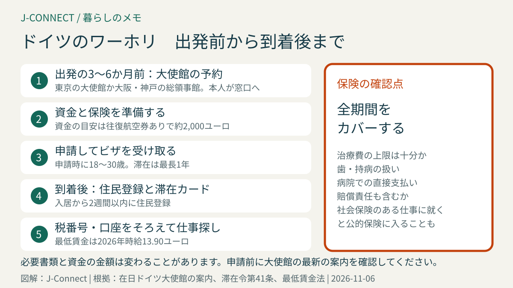
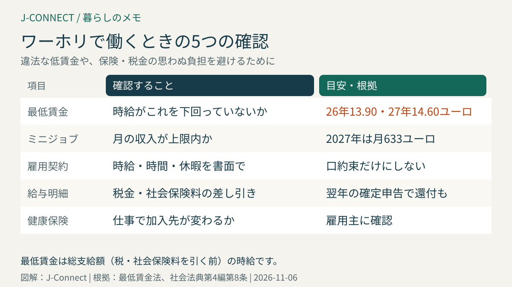

# ドイツのワーキングホリデー｜18〜30歳の条件、資金の目安、保険、申請の流れ、到着後の手続きと仕事探し

ワーキングホリデーは、若い人が相手の国で休暇を過ごしながら、旅の費用を補うために働くことを認める制度です。日本とドイツの間にもこの制度があり、18歳から30歳の日本人は最長1年、ドイツに住んで働けます。この記事は、ドイツでのワーホリを考えている人に向けて、申請の条件と書類、資金と保険の準備、到着後の手続き、仕事の探し方、滞在後の進路までを順番に整理します。読み終えると、出発の何か月前に何をすればよいかが分かります。

## まず結論：ドイツのワーホリの要点

- **対象**：申請時に18歳以上30歳以下の日本国籍者
- **期間**：最長1年
- **目的**：主な目的は休暇。旅の費用を補うための就労が認められます
- **申請先**：多くの人は、出発前に在日ドイツ大使館（東京）か総領事館（大阪・神戸）で申請します
- **主な準備**：資金の証明、滞在期間すべてをカバーする健康保険、航空券など

必要書類や資金の金額は見直されることがあります。この記事は大使館の案内と滞在法をもとにした概要なので、申請前に必ず在日ドイツ大使館の最新の案内を確認してください。

## 申請の条件と書類

在日ドイツ大使館の案内や、実際に申請した人の情報によると、一般的に次のような書類が求められます。

- 長期ビザの申請書（オンラインで作成して印刷し、署名したもの）
- パスポート（ビザの期限が切れた後も一定期間の有効期間が残っているもの）と写真
- **資金の証明**：銀行の残高証明や通帳の写しなど
- **健康保険の加入証明**：ドイツ滞在の全期間をカバーするもの
- **航空券**：往復の予約、または帰りの航空券を買える資金の証明
- 滞在の計画を説明する書類（動機書や履歴書など）

資金の目安として、往復の航空券がある場合で**約2,000ユーロ**、片道だけの場合はそれより多くの資金を求められると案内されることが一般的です。金額や書類の形式は年によって変わるので、大使館の最新の案内に従ってください。

申請は本人が窓口に出向く必要があり、事前のオンライン予約が必要です。夏から秋に出発したい人が多く、予約が混み合う時期もあるため、**出発の3〜6か月前**には予約を確認しておくと安心です。

### ドイツ国内で申請できる？

日本国籍の人は、ビザなしでドイツに入国し、入国から90日以内に外国人局で滞在許可を申請できるしくみがあります（滞在令第41条）。ワーキングホリデーも、自治体によってはドイツ国内で申請を受け付けています。ただし、大都市の外国人局は予約が取りにくく、許可が出るまで働けないので、**日本でビザを取ってから出発する人が多い**のが実情です。国内で申請したい場合は、住む予定の市の外国人局の案内を事前に確認してください。

## 健康保険の選び方

ドイツでは、どの滞在許可でも健康保険の加入が条件です。ワーホリでは、日本の海外旅行保険や、ワーホリ向けの民間保険に入る人が一般的です。選ぶときは、次の点を確認します。

- **滞在の全期間**（最長1年）をカバーしているか
- 病気やけがの治療費に上限がないか、十分な金額か
- 歯の治療、持病、妊娠などが対象外になっていないか
- ドイツの病院で、保険会社が直接支払うしくみ（キャッシュレス）が使えるか
- 個人の賠償責任（他人の物を壊したときなど）も含まれるか

ドイツの会社で週に一定以上働き、社会保険の加入義務がある仕事に就いた場合は、ドイツの公的健康保険に入ることになります。働き方によって加入先が変わるので、仕事が決まったら雇用主に確認してください。保険のしくみは[ドイツの健康保険](/germany/ja/living/health-insurance-guide/)で説明しています。ドイツでは他人に損害を与えたときの賠償責任保険も広く使われています。[ドイツの個人賠償責任保険と家財保険](/germany/ja/living/liability-household-insurance-germany/)も参考にしてください。

## ドイツに着いてからの手続き

1. **住まいを決める**：最初は短期の家具付きの部屋や、共同生活の部屋（WG）を借りる人が多いです。[ドイツの賃貸・家探し](/germany/ja/living/rent-apartment-germany/)で詐欺の手口も確認してください。
2. **住民登録をする**：入居後2週間以内に住民登録をします。手順は[ドイツの住民登録](/germany/ja/living/anmeldung-guide/)で説明しています。
3. **ビザの期限内に滞在許可カードを受け取る**：日本で取ったビザの期間が1年より短い場合は、期限内に外国人局で電子滞在カードを申請します。ビザに書かれた期間と条件を確認してください。
4. **税番号を受け取る**：住民登録の後、税番号（Steuer-ID）が郵送で届きます。働くときに雇用主へ伝えます。[税番号と税区分](/germany/ja/living/tax-id-steuernummer-steuerklasse/)を参考にしてください。
5. **銀行口座と携帯電話**：給料の受け取りには口座が必要です。[ドイツの銀行口座開設](/germany/ja/living/bank-account-germany/)と[ドイツの携帯電話・SIMの選び方](/germany/ja/living/mobile-phone-sim-germany/)にまとめています。

到着直後の1か月の全体像は[ドイツ生活の最初の30日](/germany/ja/living/germany-first-30-days/)で確認できます。

## 仕事の探し方と働き方

ワーホリの人がよく働く場所は、日本食レストランや日本食材店、日系企業の事務やイベントの手伝い、ホテルや観光の仕事などです。J-Connectの[求人ページ](/germany/ja/jobs/)や[掲示板](/germany/ja/community/)、日本人向けの情報誌、ドイツの求人サイトなどで探せます。

働くときは、次の点を知っておきましょう。

- **最低賃金**：ドイツには法律で決められた最低賃金があり、2026年は時給13.90ユーロ、2027年は14.60ユーロです（最低賃金法）。これより低い時給の仕事は違法です。
- **ミニジョブ**：月の収入が一定額以下の働き方は「ミニジョブ」と呼ばれ、税金や社会保険の扱いが異なります。2027年の上限額は[ミニジョブの上限額](/germany/ja/living/minijob-grenze-2027/)で説明しています。
- **雇用契約**：口約束ではなく、時給、労働時間、試用期間、休暇などを書面で確認します。[ドイツの労働契約](/germany/ja/living/employment-contract-germany/)に、確認したい項目をまとめています。
- **給与明細**：所得税や社会保険料が差し引かれます。働いた年に源泉徴収された税金は、[確定申告](/germany/ja/living/income-tax-return-germany/)で一部戻ることがあります。

ドイツ語ができると、仕事の選択肢が大きく広がります。到着前から[A1から始めるドイツ語ルート](/germany/ja/learn-german/a1-daily-life-german-route/)などで準備しておくと役立ちます。

## ワーホリの後の進路

ワーホリの期間中に、ドイツで長く働きたい、学びたいと考える人もいます。日本国籍の人は、ドイツ国内で別の滞在許可に切り替えられる場合があります。

- **就職する**：仕事が見つかったら、就労の滞在許可を申請します。日本国籍者は、資格を問わない就労の許可（滞在法第19c条・就労令第26条）も使えます。
- **大学や職業訓練に進む**：[ドイツの大学への留学](/germany/ja/living/study-in-germany-student-visa/)や[職業訓練](/germany/ja/living/ausbildung-germany-japanese/)の滞在許可を申請します。
- **31歳以降に仕事を探す**：学位や職業資格がある人は、[チャンスカード](/germany/ja/living/chancenkarte-germany-japanese/)も選択肢です。

切り替えは、ワーホリの期限が切れる前に申請する必要があります。それぞれの許可の条件は[ドイツのビザ・滞在許可の種類](/germany/ja/living/germany-visa-types-japanese/)で比べられます。

## 帰国するとき

ドイツを離れるときは、住民登録の抹消、銀行口座や携帯電話、保険の解約、公共放送の受信料の手続きが必要です。働いた人は、翌年に確定申告をすると税金が戻ることがあります。[ドイツから本帰国するときの手続き](/germany/ja/living/returning-to-japan-checklist/)にチェックリストをまとめています。

## よくある質問

### 31歳の誕生日の前に申請すれば間に合いますか？

年齢は申請した時点で判断されるのが一般的です。30歳のうちに申請し、許可を受ければ、滞在中に31歳になっても問題ありません。誕生日が近い人は、大使館の予約を早めに確認してください。

### ワーホリで語学学校に通えますか？

休暇の一部として語学学校に通う人は多くいます。ただし、学ぶことが主な目的になる場合は、語学コースの滞在許可を検討します。

### 2回目のワーホリはできますか？

日本とドイツの制度では、原則として1回のみとされています。最新の扱いは大使館で確認してください。

## 関連記事

- [ドイツのビザ・滞在許可の種類](/germany/ja/living/germany-visa-types-japanese/)
- [ドイツ生活の最初の30日](/germany/ja/living/germany-first-30-days/)
- [ドイツの住民登録](/germany/ja/living/anmeldung-guide/)
- [税番号と税区分](/germany/ja/living/tax-id-steuernummer-steuerklasse/)
- [ドイツのチャンスカード](/germany/ja/living/chancenkarte-germany-japanese/)

## 公式情報・参考ソース

- [在日ドイツ大使館：ワーキングホリデーの案内（PDF）](https://japan.diplo.de/resource/blob/2780828/346c1dbe106108ce931b2e5c95f390fc/wh-info-data.pdf)
- [滞在令第41条：日本国籍者などのビザなし入国と国内での申請](https://www.gesetze-im-internet.de/aufenthv/__41.html)
- [滞在法第4a条：就労できる範囲](https://www.gesetze-im-internet.de/aufenthg_2004/__4a.html)
- [就労令第26条：日本国籍者などの就労](https://www.gesetze-im-internet.de/beschv_2013/__26.html)
- [最低賃金法第1条：最低賃金](https://www.gesetze-im-internet.de/milog/__1.html)
- [社会法典第4編第8条：ミニジョブ](https://www.gesetze-im-internet.de/sgb_4/__8.html)

**参照日：2026年11月6日。** ワーキングホリデーの必要書類や資金の金額は、大使館の判断で変わることがあります。この記事は一般的な情報で、個別の法的助言ではありません。申請前に必ず在日ドイツ大使館・総領事館の最新の案内を確認してください。
