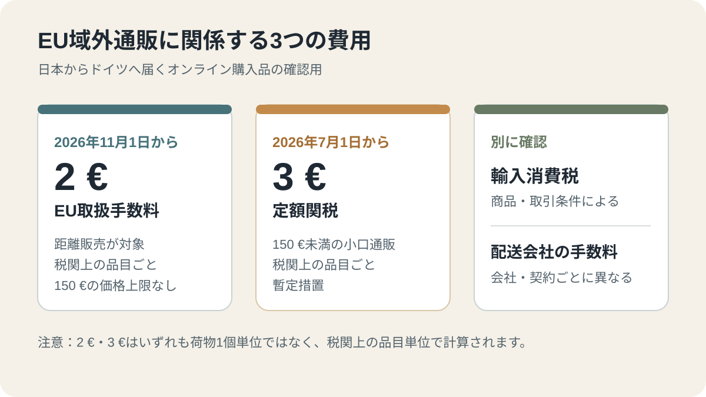
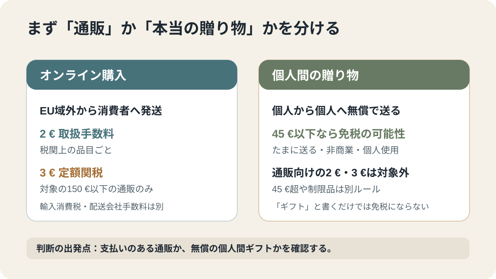

# PR #442 未公開の差分記録：germany-import-fees-japan-packages-2026

2026-11-21に旧PRの提案を保存。公開原稿ではなく、現行mainへ適用していない参考差分です。日付・法令・個別条件は改めて一次情報で確認し、必要な専門レビューを経てから採用してください。期限終了トピックは現行の案内として再公開しません。

```diff
diff --git a/content/living/germany-import-fees-japan-packages-2026.md b/content/living/germany-import-fees-japan-packages-2026.md
index 158e511..b171fcb 100644
--- a/content/living/germany-import-fees-japan-packages-2026.md
+++ b/content/living/germany-import-fees-japan-packages-2026.md
@@ -7,9 +7,9 @@ summary: "2026年11月1日から、EU域外から消費者向けに発送され
 status: "published"
 published: true
 published_at: "2026-11-07"
-updated_at: "2026-11-07"
-last_verified: "2026-11-05"
-next_review: "2026-11-10"
+updated_at: "2026-11-11"
+last_verified: "2026-11-11"
+next_review: "2026-12-15"
 canonical_url: "/germany/ja/living/germany-import-fees-japan-packages-2026/"
 image: "/assets/img/living/germany-import-fees-japan-packages-2026.webp"
 image_alt: "日本からドイツへ届く段ボール箱と税関書類を示すイラスト"
@@ -18,6 +18,8 @@ related_articles: ["christmas-post-germany-to-japan-2026", "dhl-delivered-but-no
 official_sources:
   - title: "EU理事会：小口荷物へのEU措置（3ユーロ関税・2ユーロ取扱手数料）"
     url: "https://www.consilium.europa.eu/de/policies/eu-action-influx-of-small-parcels/"
+  - title: "EU理事会：オンライン販売のVAT徴収簡素化に合意（2026年11月9日、正式採択前）"
+    url: "https://www.consilium.europa.eu/de/press/press-releases/2026/11/09/taxation-council-approves-further-vat-simplification-rules-for-online-sales/"
   - title: "欧州委員会DG TAXUD：3ユーロ関税・2ユーロ取扱手数料の技術ガイダンス（2026年10月5日版、法的拘束力なし）"
     url: "https://taxation-customs.ec.europa.eu/document/download/053e5b4e-f0be-4f20-9a23-3e3b659a6676_en?filename=Customs+Guidance+on+EUR+3+customs+duty.pdf"
   - title: "EU理事会：3ユーロ定額関税の最終承認（2026年2月11日）"
@@ -36,9 +38,9 @@ official_sources:

 # 日本からドイツに届く荷物の関税は？2026年11月の2ユーロ手数料と3ユーロ定額関税

-日本の通販サイトで買った商品をドイツに送る場合、2026年11月1日からEUの取扱手数料2ユーロが適用されています。荷物の本質的価値が150ユーロ以下の対象通販には、2026年7月1日から3ユーロの定額関税も別途かかる場合があります。2ユーロと3ユーロは、いずれもEU関税法上の「品目」を単位として計算されますが、対象となる荷物の価値と適用期間が異なります。輸入消費税や配送会社の手数料とは別です。通販、個人間ギフト、EU内倉庫から発送される商品を分け、追加費用の見分け方を説明します。
+日本の通販サイトからドイツへ商品を送る場合、2026年11月1日からEUの取扱手数料2ユーロが適用されています。本質的価値150ユーロ以下の対象通販には、2026年7月1日から3ユーロの暫定関税も別途かかる場合があります。EU理事会は2026年11月9日、2028年7月からのVAT徴収ルール拡大にも合意しましたが、正式採択前です。この記事では、現在の追加費用と個人間ギフトの扱い、今後の変更を分けて説明します。

-
+

 ## この記事でわかること

@@ -97,7 +99,7 @@ EUの新しい税関制度では、距離販売に関する税関手続きや費
 - 受取人本人や家庭で使うためのものである
 - 代金や交換の対価を支払っていない

-
+

 この条件を満たす私的な贈り物は、通販の距離販売を対象とする2ユーロの取扱手数料の対象ではありません。150ユーロ以下の対象距離販売に対する3ユーロの定額関税も、個人間の贈り物にそのまま当てはめる制度ではありません。

@@ -114,6 +116,16 @@ EUの新しい税関制度では、距離販売に関する税関手続きや費

 EU委員会の技術ガイダンスでは、取扱手数料の債務者は原則として税関申告を行う申告者です。通常の通販では販売者・プラットフォーム・通関代理人などが申告を担いますが、IOSSを使わず、追加費用なしで個人がオンライン申告できる仕組みを設けている一部の加盟国では、消費者自身が申告者となる例外もあります。販売者が費用を商品価格や送料に反映することもあるため、受取人に請求されないとは限りません。請求書の内訳と購入時の表示を照合してください。

+## 2028年からのVAT徴収ルールはどう変わる？
+
+2026年11月9日、EU理事会は、EU向けオンライン販売の付加価値税（VAT）の徴収を簡素化する追加措置に合意しました。現在の輸入ワンストップショップ（IOSS）は本質的価値150ユーロ未満の対象販売で利用できますが、合意された案では、価値を問わない商品と、EU域外事業者がEU内の保税倉庫に保管した商品にも利用範囲を広げます。
+
+さらに2028年7月1日からは、EU域外のオンラインプラットフォームが、EU向けに販売する商品について、価値にかかわらずVAT上の「みなし供給者」として扱われる予定です。プラットフォーム自身が、元の販売者に代わってVATを徴収し、各国当局へ納付する仕組みです。理事会の説明では、プラットフォームはVATと関税を最終的な購入価格に表示・含めることが想定されています。
+
+ただし、2026年11月11日時点では理事会の合意段階です。欧州議会への諮問を経て理事会が正式採択する手続きが残っており、すでに施行されたルールではありません。2028年7月1日の適用予定日や最終的な条文は、正式採択後に再確認してください。
+
+今の買い物で確認する点は変わりません。2026年11月の2ユーロ取扱手数料と3ユーロ暫定関税は、VAT徴収の仕組みとは別の税関上の負担です。IOSSの対象拡大も、すべての通販が自動的にIOSSを使うという意味ではありません。注文画面の税・関税の表示と、配送会社からの請求内訳を分けて確認してください。
+
 ## よくある質問

 ### 2ユーロは荷物1個につきかかりますか？
@@ -155,3 +167,6 @@ EU委員会の技術ガイダンスでは、主な債務者は税関申告を行
 - [EU規則2026/2108](https://eur-lex.europa.eu/legal-content/EN/TXT/?uri=CELEX:32026R2108)
 - [EU委任規則2026/2152](https://eur-lex.europa.eu/legal-content/EN/TXT/?uri=CELEX:32026R2152)
 - [ドイツ税関：郵便・通販荷物と贈り物の案内（PDF）](https://www.zoll.de/SharedDocs/Downloads/DE/Publikation/Broschuere/Reise-Post/faltblatt_zoll_post_internethandel.pdf?__blob=publicationFile&v=4)
+- [EU理事会：オンライン販売のVAT徴収簡素化に合意（2026年11月9日、正式採択前）](https://www.consilium.europa.eu/de/press/press-releases/2026/11/09/taxation-council-approves-further-vat-simplification-rules-for-online-sales/)
+
+確認日：2026年11月11日。2028年のVAT変更は理事会合意段階のため、正式採択後に内容と適用日を再確認してください。
```
