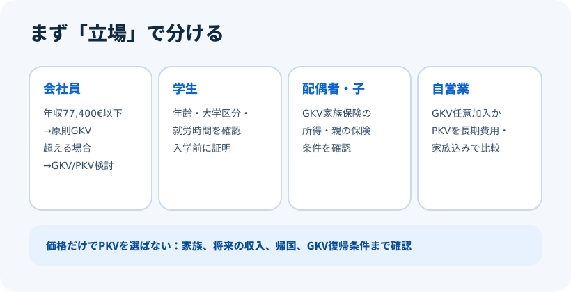

# PR #442 未公開の差分記録：health-insurance-guide

2026-11-21に旧PRの提案を保存。公開原稿ではなく、現行mainへ適用していない参考差分です。日付・法令・個別条件は改めて一次情報で確認し、必要な専門レビューを経てから採用してください。期限終了トピックは現行の案内として再公開しません。

```diff
diff --git a/content/living/health-insurance-guide.md b/content/living/health-insurance-guide.md
index 1d82c2b..6d34367 100644
--- a/content/living/health-insurance-guide.md
+++ b/content/living/health-insurance-guide.md
@@ -1,23 +1,29 @@
 ---
 id: "L003"
-title: "ドイツの健康保険の選び方｜公的と民間の違い・保険料率14.6%＋追加・加入の流れ"
+title: "ドイツの健康保険の選び方｜公的保険と民間保険、保険料率、2027年の基準、加入の流れ"
 slug: "health-insurance-guide"
 category: "医療・健康"
 tags: ["健康保険","公的医療保険","民間医療保険","医療","渡独後手続き"]
-summary: "ドイツの健康保険を会社員・学生・家族など立場別に解説。公的保険と民間保険の違い、保険料率（14.6%＋追加保険料）、2026年の基準、加入証明の提出先、保険証が届く前の受診用証明まで整理します。"
+summary: "ドイツの健康保険を会社員・学生・家族など立場別に解説。公的保険と民間保険の違い、2026・2027年の加入義務ラインと保険料算定上限、追加保険料率、加入証明と保険証未着時の受診方法を整理します。"
 status: "published"
 published: true
 published_at: "2026-06-07"
-updated_at: "2026-11-06"
-last_verified: "2026-11-06"
-next_review: "2027-01-15"
+updated_at: "2026-11-10"
+last_verified: "2026-11-10"
+next_review: "2026-11-21"
 canonical_url: "/germany/ja/living/health-insurance-guide/"
 image_url: "/assets/images/living/german-clinic-reception-editorial-v1.webp"
 image_alt: "ドイツの診療所で保険と受診について受付に確認するイメージ"
-related_articles: ["germany-first-30-days","anmeldung-guide","doctor-appointment-germany","residence-permit-renewal-germany","pregnancy-birth-germany","epa-guide-germany"]
+related_articles: ["germany-first-30-days","anmeldung-guide","doctor-appointment-germany","residence-permit-renewal-germany","pregnancy-birth-germany","epa-guide-germany","pflegeversicherung-reform-2027"]
 official_sources:
   - title: "連邦保健省：公的医療保険の加入者・2026年の基準"
     url: "https://www.bundesgesundheitsministerium.de/gesetzlich-versicherte/seite"
+  - title: "連邦労働・社会省：2027年の社会保険基準額と連邦参議院の審議状況"
+    url: "https://www.bmas.de/DE/Service/Gesetze-und-Gesetzesvorhaben/sozialversicherungs-rechengroessenverordnung-2027.html"
+  - title: "ドイツ年金保険：2027年の保険料算定上限（2026年10月8日）"
+    url: "https://www.deutsche-rentenversicherung.de/DRV/DE/Ueber-uns-und-Presse/Presse/Meldungen/2026/261008-bundeskabinett-sv-rechengroessen-2027"
+  - title: "連邦保健省：2027年の平均追加保険料率を2.9％に決定（2026年10月30日）"
+    url: "https://www.bundesgesundheitsministerium.de/presse/pressemitteilungen/zusatzbeitragssatz-gkv-2027-festgelegt"
   - title: "連邦保健省：公的保険と民間保険の変更"
     url: "https://www.bundesgesundheitsministerium.de/themen/krankenversicherung/online-ratgeber-krankenversicherung/krankenversicherung/wechsel-zwischen-gkv-und-pkv"
   - title: "AOK：保険証が未着の場合を含む代替証明の案内"
@@ -26,6 +32,14 @@ official_sources:
     url: "https://www.bundesgesundheitsministerium.de/themen/digitalisierung/elektronische-patientenakte/epa-fuer-alle"
   - title: "連邦健康情報ポータル：ePAの管理とアクセス"
     url: "https://gesund.bund.de/wie-verwalte-ich-meine-epa"
+  - title: "連邦議会：介護保険改革案の第1読会（2026年11月5日）"
+    url: "https://www.bundestag.de/dokumente/textarchiv/2026/kw45-de-pflegeneuordnungsgesetz-1225076"
+  - title: "連邦保健省：介護保険改革案（PNOG）"
+    url: "https://www.bundesgesundheitsministerium.de/service/gesetze-und-verordnungen/guv-21-lp/pnog"
+  - title: "社会法典第5編 §6（年間賃金基準）"
+    url: "https://www.gesetze-im-internet.de/sgb_5/__6.html"
+  - title: "社会法典第11編 §55（介護保険の保険料算定上限）"
+    url: "https://www.gesetze-im-internet.de/sgb_11/__55.html"
 ---

 # ドイツの健康保険｜公的保険と民間保険をどう選ぶか
@@ -57,21 +71,39 @@ official_sources:

 

-## 2026年、会社員はどちらになるか
+## 会社員の加入義務ラインはどう決まるか

-2026年は、会社員の年間総収入が原則7万7,400ユーロ以下で、月603ユーロを超える場合、公的保険への加入義務が生じます。基準を超える会社員は、公的保険に任意で残るか、条件を満たして民間保険へ移る選択肢が生まれます。
+会社員は、継続的に見込まれる年間報酬がその年の加入義務ライン以下であれば、原則として公的健康保険への加入義務があります。2026年の一般基準は年77,400ユーロ（月6,450ユーロ）です。基準を超える場合は、要件を満たせば加入義務がなくなり、公的保険に任意加入するか、民間保険を選ぶ可能性があります。学生、ミニジョブ、公務員、短時間勤務などには別の加入ルールがあるため、この一般基準だけで判断しないでください。

-この金額は、保険料計算の上限とは別の基準で、毎年改定されます。また、賞与や継続的な手当を収入にどう含めるかは個別判断があります。境目にいる人は、勤務先の給与担当と保険者の双方に確認してください。
+この基準は、保険料計算の上限とは別です。賞与や継続的な手当を年間報酬にどう含めるかは支給条件などで変わるため、境界付近の人は勤務先の給与担当と保険者の双方に確認してください。

-会社員の公的保険料は、基本保険料と保険者ごとの追加保険料を合わせ、原則として勤務先と本人が半分ずつ負担します。追加保険料は保険者ごとに違うため、同じ収入でも負担が完全に同じとは限りません。
+### 2027年の予定値（2026年11月10日確認）
+
+2027年の基準額は、2026年10月7日に連邦内閣が決定しました。2026年11月10日時点では、年次の社会保険基準額規則について連邦参議院の同意待ちです。以下は最終公布前の予定額です。
+
+| 基準 | 2027年の予定額 | 主な用途 |
+| --- | ---: | --- |
+| 一般の健康保険加入義務ライン | 年84,150ユーロ（月7,012.50ユーロ） | 一般の会社員の加入義務判定 |
+| 2026年末時点の対象者向け特例ライン | 年80,550ユーロ（月6,712.50ユーロ） | 2026年12月31日時点で報酬超過により加入義務がなく、民間の代替健康保険に加入していた会社員 |
+| 2002年末時点の対象者向け特例ライン | 年72,900ユーロ（月6,075ユーロ） | 2002年12月31日時点からの経過措置対象者 |
+| 健康保険（GKV）の保険料算定上限 | 年76,500ユーロ（月6,375ユーロ） | 公的健康保険の保険料計算 |
+| 社会介護保険の保険料算定上限（現行法の参照関係による2027年予定値） | 年72,900ユーロ（月6,075ユーロ） | 社会法典第11編第55条第2項が社会法典第5編第6条第7項の基準を参照 |
+| 社会介護保険の保険料算定上限（PNOG政府案） | 年76,500ユーロ（月6,375ユーロ） | 政府案が成立した場合の予定額。2026年11月10日時点では法案段階 |
+| 一般年金保険・失業保険の保険料算定上限 | 年106,200ユーロ（月8,850ユーロ） | 年金保険・失業保険の保険料計算 |
+
+**重要：健康保険と介護保険の上限は、2027年時点で同じとは限りません。** 2027年の社会保険基準額規則は連邦参議院の同意待ちです。現行法の参照関係に2027年予定値を当てはめると、社会介護保険の上限は年72,900ユーロ（月6,075ユーロ）です。一方、介護保険の政府案（PNOG）は上限を月300ユーロ引き上げる内容で、成立すれば年76,500ユーロ（月6,375ユーロ）になります。2026年11月10日時点では法案段階です。詳しくは[介護保険改革案の解説](/germany/ja/events/news/pflegeversicherung-reform-2027/)、[社会法典第11編第55条](https://www.gesetze-im-internet.de/sgb_11/__55.html)、[連邦保健省のPNOG案](https://www.bundesgesundheitsministerium.de/service/gesetze-und-verordnungen/guv-21-lp/pnog)を確認してください。
+
+一般の加入義務ラインと健康保険の保険料算定上限には、2026年に成立した健康保険料安定化法による年額3,600ユーロ（月額換算300ユーロ）の追加引上げが反映されています。一方、80,550ユーロの特例ラインは別の経過措置であり、この追加引上げを重ねて足すものではありません。最終的な対象条件は、法令の公布内容と自分の加入履歴を照合してください。
+
+### 年の途中で加入義務ラインを超えた場合
+
+既存の会社員は、年収見込みが加入義務ラインを超えた月から直ちに公的保険の加入義務がなくなるとは限りません。社会法典第5編第6条第4項では、加入義務ラインを超えた年の12月31日に加入義務が終了するのが原則ですが、翌年1月1日から適用される加入義務ラインも超える報酬見込みであることが条件です。新規採用者の判定とは区別し、昇給日、継続的な報酬見込み、翌年の基準額を給与担当者と保険者に確認してください。

-### 2027年の予定値

-2027年は、加入義務の年収基準が**8万4,150ユーロ**に上がる予定です。2026年12月31日時点ですでに民間保険に入っていて加入義務がない人には、別に8万550ユーロの基準が設けられる予定です。少額雇用（ミニジョブ）の上限も、最低賃金の引き上げに合わせて月633ユーロになります。基準の数値は、2026年11月6日時点で閣議決定済み・連邦参議院の同意待ちです（[テクニカー保険組合の雇用主向け案内](https://www.tk.de/firmenkunden/versicherung/jahreswechsel/jw-beitraee-und-rechengroessen/sv-rechengroessen-2027-2227000)、[2027年1月からの変更点](/germany/ja/events/news/germany-january-2027-changes/)）。

 ## 公的保険の保険料はどう決まるか

-公的保険の保険料率は、全国一律の一般保険料率14.6%に、加入している保険組合ごとの追加保険料率を足したものです。会社員の場合、どちらも雇用主と本人が半分ずつ負担します。追加保険料率の計算上の平均は、2026年も2027年も2.9%ですが、実際の率は保険組合ごとに違います（[連邦保健省](https://www.bundesgesundheitsministerium.de/beitraege)）。
+公的保険の保険料率は、全国一律の一般保険料率14.6%に、加入している保険組合ごとの追加保険料率を足したものです。会社員の場合、通常は雇用主と本人が半分ずつ負担します。連邦保健省は2026年10月30日、2027年の平均追加保険料率を2.9%に決定しました。ただし、これは全ての保険組合が同じ2.9%を請求するという意味ではなく、実際の追加保険料率は保険組合ごとに異なります（[連邦保健省の決定発表](https://www.bundesgesundheitsministerium.de/presse/pressemitteilungen/zusatzbeitragssatz-gkv-2027-festgelegt)、[公的医療保険の保険料](https://www.bundesgesundheitsministerium.de/beitraege)）。

 保険組合を比べるときは、追加保険料率の差が年間でいくらになるかを計算してみると判断しやすくなります。計算例と乗り換えの手順は、[2027年の追加保険料率の記事](/germany/ja/events/news/health-insurance-zusatzbeitrag-2027/)で紹介しています。
```
