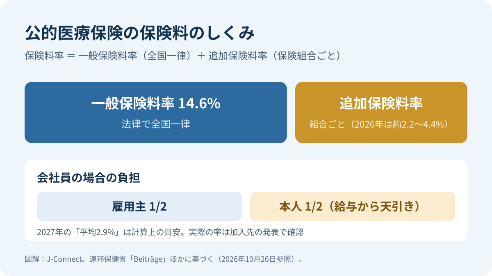

# PR #442 未公開の差分記録：health-insurance-zusatzbeitrag-2027

2026-11-21に旧PRの提案を保存。公開原稿ではなく、現行mainへ適用していない参考差分です。日付・法令・個別条件は改めて一次情報で確認し、必要な専門レビューを経てから採用してください。期限終了トピックは現行の案内として再公開しません。

```diff
diff --git a/content/events/news/health-insurance-zusatzbeitrag-2027.md b/content/events/news/health-insurance-zusatzbeitrag-2027.md
index 11f9420..7dcd56c 100644
--- a/content/events/news/health-insurance-zusatzbeitrag-2027.md
+++ b/content/events/news/health-insurance-zusatzbeitrag-2027.md
@@ -3,13 +3,17 @@ slug: "health-insurance-zusatzbeitrag-2027"
 id: "N025"
 content_type: "news"
 category: "医療・健康"
-title: "【2027年】ドイツの健康保険料は上がる？ 追加保険料率「平均2.9%据え置き」の意味と乗り換え方"
-summary: "2027年の公的医療保険の追加保険料率は、計算上の平均が2.9%で据え置きの見通しです。ただし実際の率は加入先ごとに決まり、2026年7月からは値上げのお知らせの手紙も義務ではなくなりました。負担差の計算例、特別解約権、乗り換えの手順を整理します。"
+title: "【2027年】ドイツの健康保険料は上がる？平均追加保険料率2.9％決定と乗り換え方"
+summary: "連邦保健省は2026年10月30日、2027年の公的医療保険の平均追加保険料率を2.9％に決定しました。ただし各保険組合の実際の料率は異なります。値上げ通知、特別解約権、手取りへの影響、乗り換え手順を整理します。"
 official_sources:
+  - title: "連邦保健省：2027年の平均追加保険料率を2.9％に決定（2026年10月30日）"
+    url: "https://www.bundesgesundheitsministerium.de/presse/pressemitteilungen/zusatzbeitragssatz-gkv-2027-festgelegt"
   - title: "連邦保健省：GKV推計委員会の結果「平均追加保険料率は安定」（2026年10月14日）"
     url: "https://www.bundesgesundheitsministerium.de/presse/pressemitteilungen/ergebnisse-gkv-schaetzerkreis-zusatzbeitragssatz"
   - title: "連邦保健省：公的医療保険の保険料（Beiträge）"
     url: "https://www.bundesgesundheitsministerium.de/beitraege"
+  - title: "連邦労働・社会省：2027年の社会保険基準額"
+    url: "https://www.bmas.de/DE/Service/Gesetze-und-Gesetzesvorhaben/sozialversicherungs-rechengroessenverordnung-2027.html"
   - title: "連邦保健省：GKV保険料率安定化法（GKV-BStabG）"
     url: "https://www.bundesgesundheitsministerium.de/service/gesetze-und-verordnungen/detail/gkv-beitragssatzstabilisierungsgesetz"
   - title: "社会法典第5編 §175（保険組合の選択・解約）"
@@ -24,44 +28,36 @@ related_articles: ["health-insurance-guide", "germany-january-2027-changes", "ta
 city: "ドイツ全土"
 area: "ドイツ全土"
 location: ""
-event_date: "2026-11-01までに2027年の平均追加保険料率を告示"
+event_date: "2026-10-30（2027年の平均追加保険料率の決定日）"
 next_review: "2026-12-15"
 tags: ["健康保険", "公的医療保険", "追加保険料", "Zusatzbeitrag", "保険組合", "乗り換え", "2027年", "ドイツ生活", "手取り"]
 published: true
 status: "published"
 source_type: "manual"
 published_at: "2026-10-26"
-updated_at: "2026-10-26"
-last_verified: "2026-10-26"
+updated_at: "2026-11-10"
+last_verified: "2026-11-10"
 canonical_url: "/germany/ja/events/news/health-insurance-zusatzbeitrag-2027/"
-official_url: "https://www.bundesgesundheitsministerium.de/presse/pressemitteilungen/ergebnisse-gkv-schaetzerkreis-zusatzbeitragssatz"
+official_url: "https://www.bundesgesundheitsministerium.de/presse/pressemitteilungen/zusatzbeitragssatz-gkv-2027-festgelegt"
 image: "/assets/img/events/health-insurance-zusatzbeitrag-2027.webp"
 image_alt: "台所のテーブルで手紙を見比べ、電卓で計算する人を描いたイラスト"
 image_caption: "イラスト：J-Connect。追加保険料率のテーマを表したもので、実在の保険証や公式資料を再現していません。"
 image_credit: "Illustration / J-Connect"
 ---

-# 【2027年】ドイツの健康保険料は上がる？ 追加保険料率「平均2.9%据え置き」の意味と乗り換え方
+# 【2027年】ドイツの健康保険料は上がる？平均追加保険料率2.9％決定と乗り換え方

-ドイツの公的医療保険（GKV）で、2027年の「追加保険料率（Zusatzbeitrag）」の目安が発表されました。計算上の平均は2.9%で、2026年と同じ「据え置き」です。ただ、実際に給与から引かれる率は加入している保険組合（Krankenkasse）ごとに決まるため、「自分の保険料も変わらない」とは限りません。
+ドイツの公的医療保険（GKV）について、連邦保健省は2026年10月30日、2027年の平均追加保険料率を2.9％に正式決定しました。これは2026年と同じ水準ですが、全ての保険組合が2.9％を請求するわけではありません。実際の追加保険料率は加入先ごとに決まるため、自分の給与から引かれる金額は変わる可能性があります。

-この記事は、ドイツで公的医療保険に加入して働く方、その家族、これから加入する方に向けたものです。発表の中身、手取りへの影響の計算例、保険組合が値上げしたときに使える「特別解約権」と乗り換えの手順を、法律の条文に沿って整理します（2026年10月26日時点）。
+この記事は、ドイツで公的医療保険に加入して働く方、その家族、これから加入する方に向けたものです。決定済みの平均値と保険組合別の料率の違い、手取りへの影響、値上げ時の特別解約権と乗り換え手順を整理します（2026年11月10日確認）。

 ## 何が発表されたのか

-公的医療保険の財政を見通す「推計委員会（Schätzerkreis）」が2026年10月13日・14日に会合を開き、2027年の収支見通しをまとめました。連邦保健省（BMG）はこれを受け、10月14日に「平均追加保険料率は来年も安定する」と発表しています（[連邦保健省](https://www.bundesgesundheitsministerium.de/presse/pressemitteilungen/ergebnisse-gkv-schaetzerkreis-zusatzbeitragssatz)）。
+公的医療保険の財政を見通す推計委員会は、2026年10月14日に2027年の収支見通しを示しました。この段階で示された2.9％は、収支見通しに基づく平均追加保険料率の見込みでした。

-| 項目 | 2027年の見通し |
-| --- | --- |
-| 医療基金（Gesundheitsfonds）の収入 | 3,207億ユーロ（連邦補助131.5億ユーロを含む） |
-| 保険組合の支出 | 3,781億ユーロ（前年比約3%増） |
-| 計算上の平均追加保険料率 | 2.9%（2026年と同じ） |
+その後、連邦保健省は2026年10月30日、2027年の平均追加保険料率を**2.9％に決定**しました。2026年と同じ水準です。したがって、従来の「11月1日までの告示を待つ」「正式な決定は未確認」という説明は、現在は古くなっています（[連邦保健省：2026年10月30日付決定発表](https://www.bundesgesundheitsministerium.de/presse/pressemitteilungen/zusatzbeitragssatz-gkv-2027-festgelegt)）。

-数値は報道各社が伝えた推計委員会の結果によります（[zm-online](https://www.zm-online.de/news/detail/gkv-schaetzerkreis-legt-prognose-fuer-2026-und-2027-vor)、[Deutsche Handwerks Zeitung](https://www.deutsche-handwerks-zeitung.de/krankenkassen-beitraege-sollen-2027-stabil-bleiben-385096/)）。
-
-連邦保健省によると、据え置きの主な理由は、2026年7月に成立した「GKV保険料率安定化法（GKV-BStabG）」です。この法律は2027年の保険組合の支出を最大150億ユーロ抑える内容で、7月30日に施行されています（[連邦保健省：法律の経過](https://www.bundesgesundheitsministerium.de/service/gesetze-und-verordnungen/detail/gkv-beitragssatzstabilisierungsgesetz)）。
-
-なお、2.9%という数字は、法律上は連邦保健省が**11月1日までに連邦官報（Bundesanzeiger）で告示**して確定します（[SGB V §242a](https://www.gesetze-im-internet.de/sgb_5/__242a.html)）。10月26日時点で参照した範囲では、正式な告示はまだ確認できていません。
+ただし、決定された2.9％は全保険組合に一律適用される個別料率ではありません。各保険組合は、自らの財政状況に応じて実際の追加保険料率を決めます。2027年に加入先の料率が上がるか下がるかは、各組合の公式発表で確認してください。

 ## 「平均2.9%」と「自分の保険料」は別もの

@@ -70,13 +66,13 @@ image_credit: "Illustration / J-Connect"
 - **一般保険料率 14.6%**：法律で全国一律。
 - **追加保険料率**：保険組合ごとに、それぞれの財政状況に応じて決める。

-
+

 会社員の場合、14.6%も追加保険料も、雇用主と本人が半分ずつ負担します（[連邦保健省](https://www.bundesgesundheitsministerium.de/beitraege)）。年金受給者は年金保険機関が半分を負担します。

-「平均2.9%」は、全保険組合の支出をまかなうのに計算上必要な率で、いわば目安です。各組合はこれと関係なく自分の率を決められ、年の途中で引き上げることもあります。実際、2026年の計算上の平均も2.9%でしたが、各組合が実際に課している率の平均は約3.1%、幅は2.18%〜4.39%と報じられています（[Apotheken Umschau](https://www.apotheken-umschau.de/gesundheitspolitik/zusatzbeitrag-2027-bleibt-bei-2-9-prozent-doch-kassen-warnen-1605019.html)）。
+「平均2.9%」は、全保険組合の支出をまかなうのに計算上必要な率で、いわば目安です。各組合はこれと関係なく自分の率を決められ、年の途中で引き上げることもあります。2026年も計算上の平均は2.9％でしたが、実際の料率は保険組合ごとに異なります。特定時点の平均や最低・最高の数字だけで判断せず、加入先の最新料率を[全国組織の公式一覧](https://www.gkv-spitzenverband.de/service/krankenkassenliste/krankenkassen.jsp)で確認してください。

-公的医療保険の全国組織である GKV-Spitzenverband のオリバー・ブラット氏は、年明けの時点で法定の最低準備金を積み終えていない組合が残るとして、そうした組合では資金需要が高まりうると述べています（[Apotheken Umschau](https://www.apotheken-umschau.de/gesundheitspolitik/zusatzbeitrag-2027-bleibt-bei-2-9-prozent-doch-kassen-warnen-1605019.html)）。つまり**2027年に引き上げる組合も、引き下げる組合もありうる**というのが正確な理解です。
+つまり**2027年に引き上げる組合も、据え置く組合も、引き下げる組合もありえます**。平均値だけで自分の保険料を予測せず、加入先の公式発表を確認してください。

 ## 手取りへの影響：計算例

@@ -86,7 +82,6 @@ image_credit: "Illustration / J-Connect"
 | --- | --- | --- | --- |
 | 3,000ユーロ | 0.5ポイント | 7.50ユーロ | 90ユーロ |
 | 4,000ユーロ | 0.5ポイント | 10ユーロ | 120ユーロ |
-| 4,000ユーロ | 2.21ポイント（2.18%と4.39%の差） | 44.20ユーロ | 530.40ユーロ |
 | 6,375ユーロ以上 | 1.0ポイント | 31.88ユーロ | 382.50ユーロ |

 保険料は給与のうち「保険料算定上限」までにしか掛かりません。2027年の上限は月6,375ユーロに引き上げられる予定です（連邦参議院の同意待ち。詳しくは「[【2027年1月から】ドイツで何が変わる？](/germany/ja/events/news/germany-january-2027-changes/)」）。上限を超える給与の方は、6,375ユーロを基準に計算します。
@@ -134,7 +129,7 @@ image_credit: "Illustration / J-Connect"

 ## いつ、どこで確認すればいい？

-各保険組合の2027年の率は、例年12月ごろから年末にかけて発表されます。中には、すでに据え置きを表明した組合や、引き下げを検討していると報じられた組合もありますが、大半はまだ決まっていません（10月26日時点）。
+2027年の個別料率は各保険組合がそれぞれ決定します。2026年11月10日時点で、GKV-Spitzenverbandの公式一覧は「現在有効な追加保険料率」を掲載しており、2027年1月からの予定値を一覧だけで確定することはできません。2027年の料率を公表した組合があっても、加入先の公式通知・会員向け案内で確認してください。平均値2.9％は、すべての加入者に適用される一律の料率ではありません。

 - **公式の一覧**：GKV-Spitzenverband の[保険組合一覧](https://www.gkv-spitzenverband.de/service/krankenkassenliste/krankenkassen.jsp)で、全組合の現在の追加保険料率を比べられます。表示されるのはその日時点で有効な率です。
 - **加入先のウェブサイトやアプリ**：手紙での通知義務はなくなったため、年末に自分で一度チェックします。
@@ -169,17 +164,14 @@ image_credit: "Illustration / J-Connect"

 今回の追加保険料率は公的医療保険の話で、民間医療保険の保険料には直接関係しません。民間保険の保険料改定は、契約先からの通知で確認してください。

-## 参考情報（2026年10月26日参照）
+## 参考情報（2026年11月10日確認）

+- [連邦保健省：2027年の平均追加保険料率を2.9％に決定（2026年10月30日）](https://www.bundesgesundheitsministerium.de/presse/pressemitteilungen/zusatzbeitragssatz-gkv-2027-festgelegt)
 - [連邦保健省：GKV推計委員会の結果（2026年10月14日）](https://www.bundesgesundheitsministerium.de/presse/pressemitteilungen/ergebnisse-gkv-schaetzerkreis-zusatzbeitragssatz)
 - [連邦保健省：公的医療保険の保険料](https://www.bundesgesundheitsministerium.de/beitraege)
-- [連邦保健省：GKV保険料率安定化法](https://www.bundesgesundheitsministerium.de/service/gesetze-und-verordnungen/detail/gkv-beitragssatzstabilisierungsgesetz)
-- [社会法典第5編 §175](https://www.gesetze-im-internet.de/sgb_5/__175.html)・[§242](https://www.gesetze-im-internet.de/sgb_5/__242.html)・[§242a](https://www.gesetze-im-internet.de/sgb_5/__242a.html)
-- [GKV-Spitzenverband：保険組合一覧](https://www.gkv-spitzenverband.de/service/krankenkassenliste/krankenkassen.jsp)
-- [消費者センター：Zusatzbeitrag der Krankenkasse: Sonderkündigung und Wechsel möglich（2026年8月19日更新）](https://www.verbraucherzentrale.de/wissen/gesundheit-pflege/krankenversicherung/zusatzbeitrag-der-krankenkasse-sonderkuendigung-und-wechsel-moeglich-10581)
-- [zm-online：GKV推計委員会、2026年・2027年の見通し](https://www.zm-online.de/news/detail/gkv-schaetzerkreis-legt-prognose-fuer-2026-und-2027-vor)
-- [Deutsche Handwerks Zeitung：Krankenkassen-Beiträge sollen 2027 stabil bleiben](https://www.deutsche-handwerks-zeitung.de/krankenkassen-beitraege-sollen-2027-stabil-bleiben-385096/)
-- [Apotheken Umschau：Zusatzbeitrag 2027 bleibt bei 2,9 Prozent – doch Kassen warnen](https://www.apotheken-umschau.de/gesundheitspolitik/zusatzbeitrag-2027-bleibt-bei-2-9-prozent-doch-kassen-warnen-1605019.html)
-- [evangelisch.de：Schätzerkreis: Zusatzbeitrag für Krankenkassen 2027 unverändert（2026年10月14日）](https://www.evangelisch.de/inhalte/260056/14-10-2026/schaetzerkreis-zusatzbeitrag-fuer-krankenkassen-2027-unveraendert)
+- [連邦労働・社会省：2027年の社会保険基準額](https://www.bmas.de/DE/Service/Gesetze-und-Gesetzesvorhaben/sozialversicherungs-rechengroessenverordnung-2027.html)
+- [社会法典第5編 §175（保険組合の選択・解約）](https://www.gesetze-im-internet.de/sgb_5/__175.html)・[§242a（平均追加保険料率）](https://www.gesetze-im-internet.de/sgb_5/__242a.html)
+- [GKV-Spitzenverband：保険組合一覧と個別追加保険料率](https://www.gkv-spitzenverband.de/service/krankenkassenliste/krankenkassen.jsp)
+- [消費者センター：追加保険料の値上げと特別解約権（2026年8月19日更新）](https://www.verbraucherzentrale.de/wissen/gesundheit-pflege/krankenversicherung/zusatzbeitrag-der-krankenkasse-sonderkuendigung-und-wechsel-moeglich-10581)

 本記事は公開情報をもとにした一般的な情報提供で、個別の保険・法律相談に代わるものではありません。乗り換えの判断は、加入先と乗り換え先の保険組合の最新情報を確認したうえで行ってください。
```
