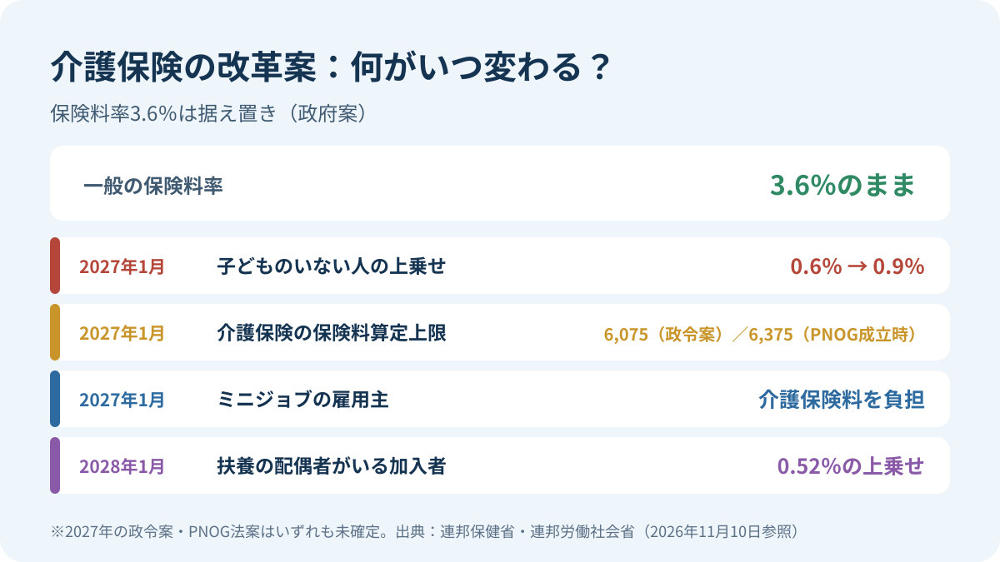

# PR #442 未公開の差分記録：pflegeversicherung-reform-2027

2026-11-21に旧PRの提案を保存。公開原稿ではなく、現行mainへ適用していない参考差分です。日付・法令・個別条件は改めて一次情報で確認し、必要な専門レビューを経てから採用してください。期限終了トピックは現行の案内として再公開しません。

```diff
diff --git a/content/events/news/pflegeversicherung-reform-2027.md b/content/events/news/pflegeversicherung-reform-2027.md
index a1d64ff..1afd995 100644
--- a/content/events/news/pflegeversicherung-reform-2027.md
+++ b/content/events/news/pflegeversicherung-reform-2027.md
@@ -14,21 +14,25 @@ official_sources:
     url: "https://www.bundesgesundheitsministerium.de/service/gesetze-und-verordnungen/guv-21-lp/pnog"
   - title: "連邦保健省：介護再編法の政府案（PDF）"
     url: "https://www.bundesgesundheitsministerium.de/fileadmin/Dateien/3_Downloads/Gesetze_und_Verordnungen/GuV/P/Kabinett-GE_Pflegeneuordnungsgesetz_PNOG.pdf"
-  - title: "連邦議会：介護保険の再編を審議（2026年11月5日）"
+  - title: "連邦議会：介護再編法案21/8869の提出（2026年11月2日）"
+    url: "https://www.bundestag.de/presse/hib/kurzmeldungen-1230676"
+  - title: "連邦議会：介護再編法案の第1読会（2026年11月5日）"
     url: "https://www.bundestag.de/dokumente/textarchiv/2026/kw45-de-pflegeneuordnungsgesetz-1225076"
+  - title: "社会法典第11編第55条：介護保険の保険料算定上限"
+    url: "https://www.gesetze-im-internet.de/sgb_11/__55.html"
 related_articles: ["health-insurance-zusatzbeitrag-2027", "germany-january-2027-changes", "health-insurance-guide"]
 city: "ドイツ全土"
 area: "ドイツ全土"
 location: ""
-event_date: "2027-01-01 施行予定（連邦議会の議決が必要）"
-next_review: "2026-12-15"
+event_date: "2027-01-01（法案成立時の予定）"
+next_review: "2026-11-21"
 tags: ["介護保険", "社会保険", "保険料", "子どものいない人", "扶養", "配偶者", "2027年", "手取り", "ドイツ生活"]
 published: true
 status: "published"
 source_type: "manual"
 published_at: "2026-10-29"
-updated_at: "2026-10-29"
-last_verified: "2026-10-29"
+updated_at: "2026-11-10"
+last_verified: "2026-11-10"
 canonical_url: "/germany/ja/events/news/pflegeversicherung-reform-2027/"
 official_url: "https://www.bundesgesundheitsministerium.de/presse/pressemitteilungen/kabinett-beschliesst-pflegeneuordnungsgesetz"
 image: "/assets/img/events/pflegeversicherung-reform-2027.webp"
@@ -52,12 +56,15 @@ image_credit: "Illustration / J-Connect"
 | 変更の案 | 時期 |
 | --- | --- |
 | 子どものいない人の上乗せ：0.6％ → **0.9％** | 2027年1月1日から |
-| 保険料を計算する月収の上限：5,812.50ユーロ → 6,375ユーロ | 2027年1月1日から |
+| 介護保険の保険料算定上限（2027年政令案・現行法）：5,812.50ユーロ → 6,075ユーロ | 2027年1月1日から（政令案） |
+| 介護保険の保険料算定上限（PNOG成立時）：5,812.50ユーロ → 6,375ユーロ | 2027年1月1日から（法案成立時の案） |
 | ミニジョブの雇用主も介護保険料を負担 | 2027年1月1日から |
 | 扶養に入っている配偶者の分に**0.52％**の上乗せ | 2028年1月1日から |

 （出典：[連邦保健省](https://www.bundesgesundheitsministerium.de/presse/pressemitteilungen/kabinett-beschliesst-pflegeneuordnungsgesetz)、[連邦保健省：よくある質問](https://www.bundesgesundheitsministerium.de/service/gesetze-und-verordnungen/guv-21-lp/pnog)）

+**重要：** 2027年の社会保険基準額政令案どおりに決定された場合、現行法に基づく介護保険の上限は月額6,075ユーロです。6,375ユーロは介護再編法案（PNOG）が成立した場合の案です。公的健康保険の2027年上限6,375ユーロとは、法的根拠と決定状況が異なります。
+
 

 ## 子どものいない人：手取りはいくら減る？
@@ -70,9 +77,10 @@ image_credit: "Illustration / J-Connect"
 | --- | --- |
 | 3,000ユーロ | 約9ユーロ |
 | 4,000ユーロ | 約12ユーロ |
-| 6,375ユーロ以上（上限） | 約19ユーロ |
+| 6,075ユーロ以上（2027年政令案・現行法） | 約18ユーロ |
+| 6,375ユーロ以上（PNOG成立時の案） | 約19ユーロ |

-（J-Connectによる概算。保険料を計算する月収の上限6,375ユーロを超える部分には、保険料はかかりません。）
+（J-Connectによる概算。2027年の政令案どおりに決定された場合、現行法の上限は月額6,075ユーロです。介護再編法案が成立した場合は6,375ユーロとなり、その上限を超える部分には介護保険料がかかりません。）

 なお、今の制度では、23歳未満の人には上乗せがかかりません。また、子どもがいる人は上乗せの対象外です。日本で生まれた子どもも含め、子どもがいることを保険組合に届け出ていない場合は、届け出が済んでいるか一度確認しましょう。

@@ -99,7 +107,7 @@ image_credit: "Illustration / J-Connect"

 ## まだ決定ではない：今後の流れ

-今回まとまったのは政府の**法案**で、まだ法律として決まったわけではありません。連邦議会は2026年11月5日に、この法案を審議する予定です（[連邦議会](https://www.bundestag.de/dokumente/textarchiv/2026/kw45-de-pflegeneuordnungsgesetz-1225076)）。審議の中で、上乗せの率や例外の条件が変わる可能性があります。
+今回まとまったのは政府の**法案**で、まだ法律として決まったわけではありません。法案番号は21/8869で、2026年11月2日に連邦議会へ提出され、11月5日に第1読会が行われました（[提出資料](https://www.bundestag.de/presse/hib/kurzmeldungen-1230676)、[第1読会](https://www.bundestag.de/dokumente/textarchiv/2026/kw45-de-pflegeneuordnungsgesetz-1225076)）。2026年11月10日時点では成立しておらず、審議の中で上乗せ率や例外条件が変わる可能性があります。

 消費者団体や労働組合は、配偶者の分への上乗せが収入の少ない家庭の負担になるとして、反対や見直しを求めています。

@@ -111,12 +119,14 @@ image_credit: "Illustration / J-Connect"

 2027年1月からのそのほかの変更は「[【2027年1月から】ドイツで何が変わる？](/germany/ja/events/news/germany-january-2027-changes/)」でまとめています。

-## 参考情報（2026年10月29日参照）
+## 参考情報（2026年11月10日参照）

 - [連邦保健省：介護再編法を閣議決定](https://www.bundesgesundheitsministerium.de/presse/pressemitteilungen/kabinett-beschliesst-pflegeneuordnungsgesetz)
 - [連邦政府：閣議で介護再編法](https://www.bundesregierung.de/breg-de/aktuelles/pflegeneuordnungsgesetz-2454862)
 - [連邦保健省：介護再編法（PNOG）のよくある質問](https://www.bundesgesundheitsministerium.de/service/gesetze-und-verordnungen/guv-21-lp/pnog)
 - [連邦保健省：介護再編法の政府案（PDF）](https://www.bundesgesundheitsministerium.de/fileadmin/Dateien/3_Downloads/Gesetze_und_Verordnungen/GuV/P/Kabinett-GE_Pflegeneuordnungsgesetz_PNOG.pdf)
-- [連邦議会：介護保険の再編を審議](https://www.bundestag.de/dokumente/textarchiv/2026/kw45-de-pflegeneuordnungsgesetz-1225076)
+- [連邦議会：介護再編法案21/8869の提出（2026年11月2日）](https://www.bundestag.de/presse/hib/kurzmeldungen-1230676)
+- [連邦議会：介護再編法案の第1読会（2026年11月5日）](https://www.bundestag.de/dokumente/textarchiv/2026/kw45-de-pflegeneuordnungsgesetz-1225076)
+- [社会法典第11編第55条：介護保険の保険料算定上限](https://www.gesetze-im-internet.de/sgb_11/__55.html)

-本記事は2026年10月29日時点の公開情報をもとにしています。法案は連邦議会で審議中で、内容は変わる可能性があります。計算例は概算で、実際の金額は保険組合や給与の条件によって異なります。
+本記事は2026年11月10日時点の公開情報をもとにしています。法案は連邦議会で審議中で、内容は変わる可能性があります。計算例は概算で、実際の金額は保険組合や給与の条件によって異なります。
```
