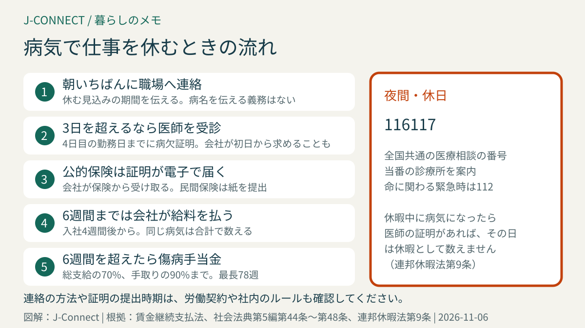
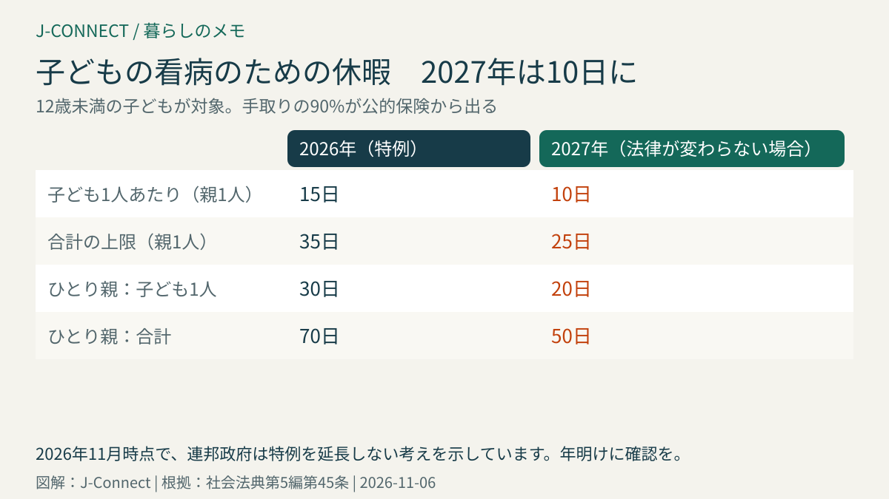

# PR #442 未公開の差分記録：sick-leave-germany

2026-11-21に旧PRの提案を保存。公開原稿ではなく、現行mainへ適用していない参考差分です。日付・法令・個別条件は改めて一次情報で確認し、必要な専門レビューを経てから採用してください。期限終了トピックは現行の案内として再公開しません。

```diff
diff --git a/content/living/sick-leave-germany.md b/content/living/sick-leave-germany.md
index fe1f87a..c621adf 100644
--- a/content/living/sick-leave-germany.md
+++ b/content/living/sick-leave-germany.md
@@ -7,8 +7,8 @@ summary: "ドイツで病気のため仕事を休むときは、すぐに職場
 status: "published"
 published: true
 published_at: "2026-11-06"
-updated_at: "2026-11-06"
-last_verified: "2026-11-06"
+updated_at: "2026-11-10"
+last_verified: "2026-11-10"
 next_review: "2027-01-15"
 canonical_url: "/germany/ja/living/sick-leave-germany/"
 tags: ["病欠", "病気休暇", "診断書", "傷病手当金", "子どもの看病", "給与", "健康保険"]
@@ -30,6 +30,8 @@ official_sources:
     url: "https://www.gesetze-im-internet.de/sgb_5/__48.html"
   - title: "社会法典第5編第45条：子どもの看病のための傷病手当金"
     url: "https://www.gesetze-im-internet.de/sgb_5/__45.html"
+  - title: "連邦保健省：子どもの看病休暇・看病傷病手当金のFAQ（2026年2月10日）"
+    url: "https://www.bundesgesundheitsministerium.de/fragen-und-antworten-zu-kinderkrankentagen-und-kinderkrankengeld"
   - title: "連邦休暇法第9条：休暇中の病気"
     url: "https://www.gesetze-im-internet.de/burlg/__9.html"
 ---
@@ -41,13 +43,13 @@ official_sources:
 ## まず結論：病気で休むときの要点

 - **すぐに連絡**：働けないと分かったら、始業前などできるだけ早く職場に連絡し、休む見込みの期間を伝えます
-- **医師の証明**：休みが3日を超えるときは、**4日目の勤務日までに**医師の病欠証明が必要です。会社が初日から求めることもあります
+- **医師の証明**：病気が**3暦日を超える場合**は、遅くともその後の**勤務日までに**医師の病欠証明を提出します。会社は初日から求めることもあります
 - **電子の証明**：公的健康保険の人は、医師が保険に送り、会社が電子で受け取ります。紙を会社に出す必要は原則ありません
 - **給料**：会社が**最長6週間**、通常どおり給料を払います
 - **6週間を超えたら**：公的保険から**傷病手当金**（総支給の70%、手取りの90%まで）が出ます
 - **子どもの看病**：12歳未満の子どもの看病で休むと、公的保険から手当が出ます。2026年は子ども1人につき年**15日**ですが、2027年は**10日**に戻る見込みです

-
+

 ## 1. 職場への連絡

@@ -104,7 +106,7 @@ official_sources:
 | 2026年 | 15日 | 35日 | 子ども1人30日、合計70日 |
 | 2027年（法律が変わらない場合） | 10日 | 25日 | 子ども1人20日、合計50日 |

-2026年の15日は、その年だけの特例です。連邦政府は2026年秋の時点で延長しない考えを示していて、法律が変わらなければ、2027年は通常の10日に戻ります。年明けに最新の情報を確認してください。
+2026年の15日・30日と年間上限35日・70日は、2024〜2026年の時限的な特例です。連邦保健省のFAQも、この特例を2026年までとして案内しています。社会法典第5編第45条第2項の通常ルールは、子ども1人につき親1人10労働日（ひとり親20日）、複数児の年間上限は25日（ひとり親50日）です。2026年11月10日時点で2027年への特例延長は確認できないため、別の延長措置がなければ2027年は通常ルールに戻ります。

 - **金額**：手取りの**90%**が基本です（直近12か月に賞与などがあれば100%）。上限があります。
 - **手続き**：医師（多くは小児科）に、子どもの看病が必要だという証明を出してもらい、保険に申請します。会社には休むことをすぐに連絡します。
@@ -112,7 +114,7 @@ official_sources:

 子どもが保育園や学校を休むときのルールは、[ドイツのKita・U3申込み](/germany/ja/living/kita-u3-tagesmutter-guide/)も参考にしてください。

-
+

 ## 休暇中に病気になったら

@@ -152,6 +154,7 @@ official_sources:
 - [社会法典第5編第47条：傷病手当金の額](https://www.gesetze-im-internet.de/sgb_5/__47.html)
 - [社会法典第5編第48条：傷病手当金の期間](https://www.gesetze-im-internet.de/sgb_5/__48.html)
 - [社会法典第5編第45条：子どもの看病のための傷病手当金](https://www.gesetze-im-internet.de/sgb_5/__45.html)
+- [連邦保健省：子どもの看病休暇・看病傷病手当金のFAQ（2026年2月10日）](https://www.bundesgesundheitsministerium.de/fragen-und-antworten-zu-kinderkrankentagen-und-kinderkrankengeld)
 - [連邦休暇法第9条：休暇中の病気](https://www.gesetze-im-internet.de/burlg/__9.html)

-**参照日：2026年11月6日。** 子どもの看病のための日数は、法律の改正で変わることがあります。この記事は一般的な情報で、個別の法的・医療的な助言ではありません。具体的な扱いは、会社の人事担当、健康保険、専門家に確認してください。
+**参照日：2026年11月10日。** 子どもの看病のための日数は、法律の改正で変わることがあります。この記事は一般的な情報で、個別の法的・医療的な助言ではありません。具体的な扱いは、会社の人事担当、健康保険、専門家に確認してください。
```
