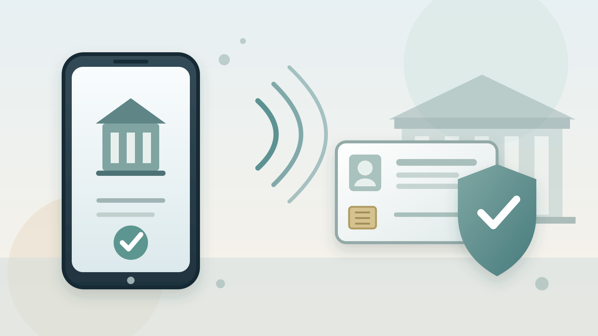

# ドイツのBundIDとは？日本人がeATで登録する方法・PINとAusweisApp

BundIDは、ドイツの行政オンライン申請で本人確認や役所からの連絡受信に使う共通アカウントです。日本人などEU域外の外国籍でも、電子滞在許可証（eAT）のオンライン本人確認機能が有効なら、高い本人確認レベルで登録できます。この記事では、登録方法、必要なPINとスマートフォン、eATがない場合の選択肢、利用時の注意点を順番に説明します。

## BundIDでできること

BundIDは、行政手続きごとに別々のログイン情報を作る負担を減らすためのアカウントです。対応するオンライン申請で本人確認に使えるほか、登録情報を申請フォームに反映したり、役所からの連絡や決定通知を受け取ったりできます。

主な機能は次のとおりです。

- 対応する国・州・自治体のオンライン申請で本人確認する
- 氏名や住所など、登録済みの情報を申請フォームに反映する
- BundIDの受信箱で役所からのメッセージや通知を受け取る
- 追加書類の提出や、役所からの質問への返信をオンラインで行う（対応する手続きの場合）

ただし、**すべての役所やオンラインサービスがBundIDに対応しているわけではありません**。申請先のポータルが指定するログイン方法と本人確認レベルを確認してください。

## 日本人など非EU居住者はeATを使える

日本国籍の人がドイツで取得する電子滞在許可証（eAT）は、オンライン本人確認に対応するカードです。ただし、カードを持っているだけでは不十分で、カードのオンライン本人確認機能が有効になっており、本人が設定した6桁のPINを使える必要があります。

BundIDの登録画面では、ドイツの身分証を持たない人向けに、電子滞在許可証とEU・EEA市民向けの電子IDカードが選択肢として案内されています。日本人などEU域外の人は、通常、自分のeATが対象になるかを確認します。

### Fiktionsbescheinigungだけの場合

Fiktionsbescheinigung（滞在資格の継続を証明する書類）は、eATのカード型電子身分証ではありません。BundIDのオンライン本人確認で使える身分証の一覧にも掲載されていません。そのため、**FiktionsbescheinigungだけでeATと同じ高い本人確認を使えるとは考えないでください**。

eATがまだ届いていない場合でも、ユーザー名とパスワードによる基本登録や、対象サービスが認める別の方法を使えることがあります。ただし、必要な本人確認レベルを満たせない申請や、受信箱の一部の通知を読めない場合があります。

## 登録方法の違い

BundIDでは、登録・ログインに使う方法によって本人確認の強さが異なります。

| 方法 | 本人確認レベル | 主な用途・制限 |
| --- | --- | --- |
| ユーザー名・パスワード | 基本 | アカウント管理や基本レベルの通知。すべての申請や通知に使えるわけではない |
| ELSTERのログイン | 実質的 | 対応する行政サービスで利用。高い本人確認が必要な手続きには足りない場合がある |
| オンライン身分証（eATなど） | 高い | 高い本人確認が必要な申請にも使える。受信箱の通知を幅広く確認できる |
| EU Identity | 提供国・サービスによる | 対応するEUの電子IDを持つ人向け |

BundIDは、オンライン身分証による登録を推奨しています。ユーザー名・パスワードだけでログインすると、セキュリティ上の理由で一部の通知や決定書を開けないことがあります。申請を完了するだけでなく、役所からの連絡をオンラインで受け取りたい場合は、利用できるならeATのオンライン本人確認を登録しておく方が便利です。

## eATで登録する前に準備するもの

必要なものは次の4点です。

1. **電子滞在許可証（eAT）**：カード本体を用意します。
2. **有効なオンライン本人確認機能**：機能が無効になっていないことを確認します。
3. **自分で設定した6桁のPIN**：5桁の一時PINとは異なります。
4. **AusweisAppと読み取り機器**：NFC対応スマートフォン、または対応するUSBカードリーダーが必要です。

### 5桁の一時PINと6桁のPINは違う

eATを申請したときに受け取るPIN案内には、通常、最初に使う5桁の一時PINが記載されています。初回利用時はAusweisAppのPIN変更機能で一時PINを使い、自分で決めた6桁のPINに変更します。

オンライン本人確認のたびに入力するのは、**自分で設定した6桁のPIN**です。一時PINをそのままBundIDのログインに入力しても使えません。

## eATでBundIDを登録する手順

### 1. AusweisAppをインストールする

公式サイトからスマートフォン、パソコン、タブレットに対応するAusweisAppを入れます。スマートフォンだけで利用する場合は、NFCに対応しているか確認してください。

- [AusweisApp公式ダウンロード](https://www.ausweisapp.bund.de/download/)

### 2. eATの機能と端末を確認する

AusweisAppの「端末と身分証を確認する」機能を使い、eATのオンライン本人確認機能が有効か、スマートフォンがカードを読み取れるかを確認します。

機能が無効の場合は、管轄の外国人局に問い合わせてください。eATの発行時に本人確認が未完了だった場合など、オンライン機能が無効で発行されるケースもあります。

### 3. 6桁のPINを設定する

5桁の一時PINがある場合は、AusweisAppのPIN変更機能で自分の6桁PINに変更します。すでに6桁PINを設定済みなら、そのPINを使います。

PINを忘れた場合は、何度も推測して入力しないでください。新しいPINの設定は、eATの場合は管轄の外国人局など、担当する身分証明窓口に確認します。

### 4. BundIDで「オンライン身分証」を選ぶ

BundID公式サイトのアカウント作成画面を開き、オンライン身分証による登録を選択します。身分証の種類で電子滞在許可証を選び、画面の案内に従ってeATをスマートフォンのNFC部分にかざします。

### 5. 読み取り内容を確認して登録する

AusweisAppの画面で、どの情報をどのサービス提供者に渡すのかを確認します。表示された情報を確認してから6桁PINを入力し、データ送信を承認します。登録画面に戻ったら、案内に従ってアカウント作成を完了します。

## 登録後にオンライン申請で使う方法

1. 利用したい行政サービスの公式ポータルを開きます。
2. ログイン方法にBundIDがあれば選択します。
3. 登録した本人確認方法（eATのオンライン身分証など）でログインします。
4. 申請フォームに表示される氏名・住所などを確認します。
5. 申請を送信した後は、BundIDの受信箱に追加質問や通知が届いていないか確認します。

オンライン申請の途中でBundIDを追加するよう求められた場合は、画面に表示された本人確認レベルを確認してください。ユーザー名・パスワードで進められない場合は、より高い本人確認が必要な手続きの可能性があります。

## eATがない・PINが分からないとき

| 状況 | 次にすること |
| --- | --- |
| eATがまだ届いていない | 基本登録やELSTERなど、申請先が認める方法を確認。高い本人確認が必要な申請は後日になる場合がある |
| Fiktionsbescheinigungだけを持っている | それをeATの代わりの電子IDとして使えるとは考えず、申請先の代替ログインを確認 |
| 5桁の一時PINがある | AusweisAppで6桁のPINに変更 |
| 6桁PINを忘れた | 管轄の外国人局などに再設定方法を確認 |
| PINがロックされた | PUKの有無を確認し、担当窓口へ相談。何度も入力を試さない |
| eATを紛失した | 管轄窓口またはオンライン本人確認の停止窓口に連絡。停止方法は公式案内で確認 |

Bundesportalの案内では、PINを忘れた場合やロックされた場合、担当窓口で新しいPINを設定する手続きが示されています。手続き方法や窓口は州・自治体によって異なるため、住んでいる地域の外国人局に確認してください。

## よくある間違い

- **5桁の一時PINを使い続ける：** オンライン本人確認で使うのは自分で設定した6桁PINです。
- **eATを持っていれば必ず使えると思う：** オンライン本人確認機能が有効か確認が必要です。
- **ユーザー名・パスワードで全ての通知を読めると思う：** 基本レベルのログインでは、一部の通知を開けない場合があります。
- **全ての自治体サービスがBundIDに対応していると思う：** 対応状況と必要な本人確認レベルは申請先ごとに確認します。
- **BundIDを滞在許可証と混同する：** BundIDはオンライン行政サービス用のアカウントであり、滞在許可そのものではありません。

## セキュリティ上の注意

AusweisAppでは、本人確認の前にサービス提供者の権限証明書を確認でき、どの情報が読み取られ、誰に送られるかを表示します。身分証の読み取りを求められたら、送信先とデータ項目を確認してから承認してください。

PINはメール、電話、一般の問い合わせフォームで他人に伝えないでください。BundIDやAusweisAppを装ったリンクからPINを入力せず、公式ドメインを直接開くことを推奨します。

## まとめ

BundIDは、対応する行政手続きをオンラインで進め、役所からの通知を受け取るための共通アカウントです。日本人など非EU居住者は、オンライン本人確認機能が有効なeATと6桁PIN、AusweisApp、NFC対応端末があれば、高い本人確認レベルで利用できます。

eATがない場合でも基本登録などを利用できることはありますが、全ての申請や通知に対応できるとは限りません。最初に利用したい行政サービスが求める本人確認レベルを確認し、それに合った登録方法を選びましょう。

## 公式情報

- [BundID：オンライン身分証を使ったアカウント登録](https://id.bund.de/de/registration/eID)
- [BundID：よくある質問](https://id.bund.de/de/faq)
- [AusweisApp：必要なもの・PIN・NFCの確認](https://www.ausweisapp.bund.de/das-brauchen-sie)
- [AusweisApp：公式ダウンロード](https://www.ausweisapp.bund.de/download/)
- [Bundesportal：電子滞在許可証（eAT）](https://verwaltung.bund.de/leistungsverzeichnis/de/leistung/99010006012000/herausgeber/RP-13125384/region/073140000000)
- [Bundesportal：オンライン本人確認のPIN再設定](https://verwaltung.bund.de/leistungsverzeichnis/de/leistung/99008004011001/herausgeber/MV-106338988/region/130000000000)

確認日：2026年11月20日。BundIDの登録方法、eATの対象、PIN・NFCの要件を公式サイトで確認しました。利用できる行政サービス、必要な本人確認レベル、窓口でのPIN再設定方法は、申請先の最新案内を優先してください。
