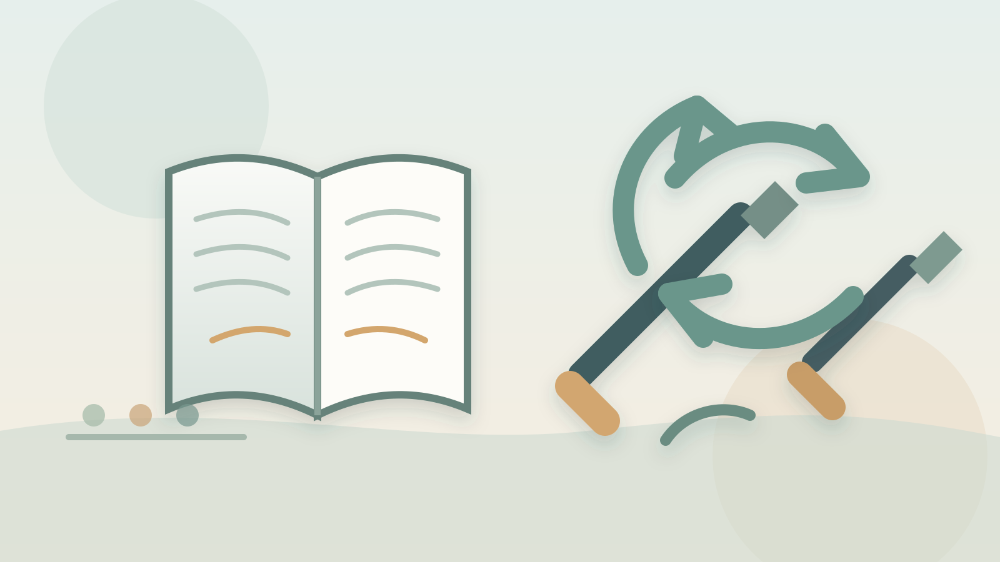

# デュッセルドルフの欧州ごみ削減週間2026｜KAP1のRepair Caféと図書館展示

デュッセルドルフでは、2026年11月21日から29日までの「欧州ごみ削減週間」に合わせ、図書館での展示や、壊れた物を直す活動を紹介するRepair Caféが行われます。主催・協力するのはAWISTA Kommunal、消費者相談センターのデュッセルドルフ窓口、市の環境・消費者保護部門です。ごみの分別だけでなく、物を長く使う方法や地域のリユース活動に関心がある人向けに、開催日と参加条件をまとめました。

## まず確認したい開催情報

2026年のテーマは「資源を大切にし、意識して選ぶ」です。公式キャンペーン期間は11月21日（土）から29日（日）までですが、図書館の展示は期間の前後にも実施されます。

| 内容 | 日時 | 場所 | 参加条件 |
| --- | --- | --- | --- |
| 中央図書館の関連書籍展示 | 11月20〜29日 | KAP1中央図書館、Konrad-Adenauer-Platz 1 | 図書館の開館時間内。案内に予約条件の記載なし |
| Bilk地区図書館の窓展示・書籍コーナー | 11月23〜30日 | Friedrichstraße 127 | 図書館の開館時間内。案内に予約条件の記載なし |
| Repair Café GarageLab | 11月28日（土）13〜17時 | KAP1中央図書館 | 無料、予約不要 |
| 資源保護についての短い講演 | 11月28日（土）15〜16時30分 | KAP1内のGarageLabのRepair Café | Repair Caféの開催時間内 |

## 1. KAP1中央図書館：11月20〜29日の書籍展示

デュッセルドルフ中央図書館KAP1では、11月20日から29日まで、ごみを減らし資源を守ることをテーマにした書籍コーナーが設けられます。AWISTAの発表では、Reduce（減らす）、Reuse（繰り返し使う）、Recycle（再資源化）に関する本が紹介されます。

住所はKonrad-Adenauer-Platz 1, 40210 Düsseldorfです。展示の個別開催時刻は公表されていないため、訪問前に[中央図書館の開館時間](https://www.duesseldorf.de/stadtbuechereien/zentralbibliothek)を確認してください。

## 2. Bilk地区図書館：11月23〜30日の窓展示

Bilk地区図書館では、11月23日から30日まで、資源を大切にする暮らしをテーマにした窓展示と書籍コーナーが設けられます。

住所はFriedrichstraße 127, 40217 Düsseldorfです。こちらもAWISTAの案内に個別の開催時刻はないため、[Bilk地区図書館の案内](https://www.duesseldorf.de/stadtbuechereien)で開館時間を確認してから訪問してください。

## 3. 11月28日のRepair Café GarageLab

今回のプログラムで、実際に参加する体験を探している人に向いているのが、11月28日（土）のRepair Caféです。開催時間は13〜17時、会場はKAP1中央図書館内のGarageLabです。AWISTAの発表では、**入場無料・予約不要**とされています。

15〜16時30分には、AWISTAのごみ相談員と消費者相談センターのデュッセルドルフ窓口が、資源保護や、地域で物を修理して長く使うことについて短い講演を行います。

ただし、公式発表には、持ち込める物の種類、修理受付の締切、部品代の扱い、当日の受付人数が記載されていません。壊れた家電や大きな家具を持ち込む予定がある場合は、事前にGarageLabまたは主催者へ確認してください。無料・予約不要という案内だけで、あらゆる物をその場で修理してもらえるとは限りません。

## どのイベントを選ぶ？

- **まず情報を集めたい：** KAP1またはBilkの図書館展示で、資源削減や再利用に関する本を探す
- **物を修理して使い続けることに関心がある：** 11月28日のRepair Caféへ行き、講演も聞く
- **初めて参加する：** まずは無料・予約不要と案内されているRepair Caféの見学から始める。ただし、修理受付の詳細は事前確認する

## 出かける前の確認

1. 図書館展示は、当日の開館時間を公式ページで確認する。
2. Repair Caféは11月28日13〜17時、講演は15〜16時30分であることを確認する。
3. 修理したい物を持参する場合は、受付可能な品目・部品・サイズを主催者に確認する。
4. 交通機関の運行情報を確認し、KAP1とBilkの会場を取り違えない。

AWISTAの公式案内には、11月19日の料理イベントも掲載されていますが、2026年11月20日時点ですでに終了しているため、これから参加できる予定には含めていません。

## 公式情報

- [AWISTA Kommunal：欧州ごみ削減週間のイベント案内（2026年11月16日）](https://www.awista-kommunal.de/aktuelles/europaeische-woche-der-abfallvermeidung-aktionen-der-abfallberatung)
- [デュッセルドルフ市：中央図書館KAP1](https://www.duesseldorf.de/stadtbuechereien/zentralbibliothek)
- [デュッセルドルフ市：市立図書館](https://www.duesseldorf.de/stadtbuechereien)

確認日：2026年11月20日。開催日、住所、Repair Caféの時間・参加費・予約条件はAWISTA Kommunalの2026年11月16日付案内で確認しました。図書館の開館時間、修理受付の対象品目・条件は、訪問前に各施設へ確認してください。
