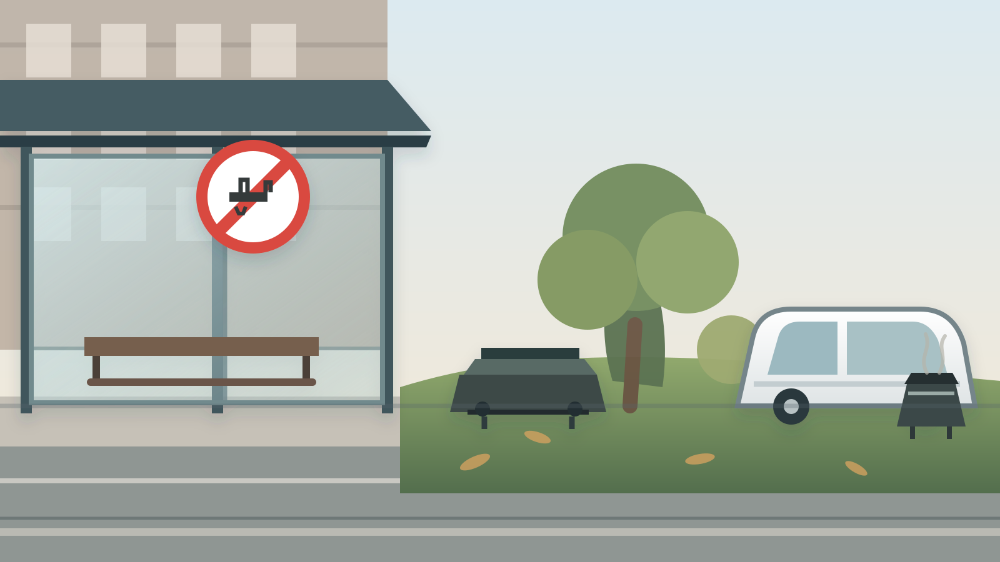

# デュッセルドルフの公共空間ルールが2027年1月に改正｜停留所の喫煙・公園の火気・車中泊

デュッセルドルフ市議会は2026年11月12日、道路・緑地に関する市条例の改正版を可決しました。新しい規則は2027年1月1日から適用され、屋根付き停留所での喫煙・電子たばこ、公共緑地でのグリル、指定外の駐車場でのキャンピングカー等の宿泊などが関係します。デュッセルドルフに住む人、通勤・観光で訪れる人が、どこで何を確認すべきかを整理します。

## まず押さえたい変更点

| 対象 | 2027年1月1日以降の変更 | 利用者が確認すること |
| --- | --- | --- |
| 地上のバス・路面電車の屋根付き待合所 | 喫煙、電子たばこ、蒸気式製品の使用を禁止 | 屋根のある待合エリアでは吸わない・使用しない |
| 公共の緑地 | 草地火災指数が3未満の場合に限り、グリル器具を使用可能 | 利用当日の指数と現地の掲示を確認 |
| 駐車場 | 指定されていない駐車場でのキャンピングカー・キャラバンの宿泊を禁止 | 宿泊可能な場所か、標識・施設案内で確認 |
| 歩道・歩行者ゾーン・店舗前 | 公共空間での睡眠に関する表現を明確化 | 公共空間での宿泊・睡眠を前提にしない |

条例全体はデュッセルドルフ市内に適用されます。NRW州全域で同じ規則が始まるわけではありません。

## いつから適用される？

市の発表によると、改正版は2026年11月12日に市議会で可決され、現行条例の終了後、**2027年1月1日**に発効します。有効期間は2046年12月31日までとされています。

今回の改正は、喫煙だけを対象にしたものではありません。公共空間の利用方法、緑地の火災予防、駐車場の利用、公共施設の保護などを含む市の条例全体の見直しです。

## 1. 屋根付きの地上停留所では喫煙・電子たばこも禁止

新たに明記されたのは、**地上にある公共交通の屋根付き待合エリア**です。バス停や路面電車の停留所にある待合所の屋根の下では、紙巻きたばこだけでなく、電子たばこや蒸気式製品も使用できなくなります。

地下鉄駅などでは、すでに喫煙や電子たばこの使用が禁止されている場所があります。今回の改正は、その対象を地上の屋根付き待合所にも広げるものです。

### どこまでが対象？

市の発表が示す対象は「屋根付きの待合エリア」です。したがって、**デュッセルドルフ市内の屋外すべてで喫煙が禁止されるわけではありません**。

WDRの2026年11月13日付報道は、屋根の外にある歩道での喫煙は今回の規則の対象外と説明しています。ただし、別の掲示や施設独自の規則がある場所では、その指示に従ってください。

市の発表資料には、この違反に対する具体的な罰金額は記載されていません。WDRは行政違反として罰金につながる可能性を伝えていますが、確認できない金額を一律の罰則として紹介することは避けます。

## 2. 公共緑地でグリルを使う前に草地火災指数を確認

市は、公共の緑地でグリル器具を使える条件を明確化しました。**ドイツ気象局の草地火災指数が3未満の場合に限り、グリル器具を使用できます。** 5段階で表示される指数なので、条件を満たすのは1または2です。

ここで確認するのは、森林の火災危険度を示す指数ではなく、草地や開けた地面の火災危険を示す「草地火災指数」です。公園での火気利用を考えるときは、似た名称の指数を取り違えないようにしてください。

### 出発前の確認手順

1. ドイツ気象局の[草地火災指数](https://www.wettergefahren.de/warnungen/indizes/grasland.html)を開きます。
2. NRWの観測地点と利用日の予測値を確認します。
3. 指数が3以上なら、公共緑地でグリル器具を使用しません。
4. 指数が3未満でも、現地の禁止表示、指定エリア、自治体の臨時規制を確認します。

草地火災指数は季節や気象条件に応じて掲載状況が変わることがあります。値が表示されていないことを「使用してよい」という意味に読み替えず、市の案内や公園の掲示を確認してください。

## 3. キャンピングカー・キャラバンの宿泊は指定場所で

市は、キャンピングカーやキャラバンで、**宿泊場所として明示的に指定されていない駐車場に泊まること**を禁止する方針を示しました。

これは、キャンピングカーを日中に駐車することまで一律に禁止するという説明ではありません。市の発表が対象としているのは「宿泊」です。駐車できるかどうかと、車内で一晩過ごせるかどうかを分けて確認してください。

旅行中に車内で泊まる場合は、キャンプ場やキャンピングカー用の宿泊区画など、宿泊が認められた場所を選びます。駐車場の標識や施設の利用条件に「駐車可」としか書かれていない場合、宿泊も可能だとは判断しないでください。

## 4. 公共空間での睡眠など、ほかの変更

市の発表では、歩道、歩行者ゾーン、店舗前などでの睡眠について、従来の表現を変更し、規則の対象を明確にすると説明されています。これは、公共空間であればどこでも自由に寝泊まりできるという意味ではありません。具体的な場所や状況は条例本文と現地の表示で確認してください。

そのほか、市は次の変更も公表しています。

- 新設された公共のスポーツ・レジャー施設を、条例の保護対象として明記
- 週刊新聞などの印刷物や包装材を公共空間に放置することへの対応を明確化
- 犬の管理に関する規則をNRW州の犬法に沿って整理し、補助犬の例外を明確化

これらの細かな適用条件や個別の罰則については、公式の条例本文・市の案内を確認してください。

## デュッセルドルフ以外でも同じ？

いいえ。今回の改正はデュッセルドルフ市の条例です。WDRは2026年11月13日の報道で、NRW州内でも停留所の喫煙ルールは自治体や交通施設によって異なると説明しています。ケルン、ボン、オーバーハウゼンなど、別の都市で同じルールが適用されると決めつけないでください。

デュッセルドルフから隣の自治体へ移動する場合は、目的地の市・交通事業者の掲示も確認しましょう。

## 外出前のチェックリスト

- **バス・路面電車を待つとき：** 屋根付き待合所では喫煙・電子たばこを使わない
- **公園でグリルをするとき：** 草地火災指数が3未満か、現地の禁止表示がないか確認
- **キャンピングカーで宿泊するとき：** その駐車場が宿泊用に指定されているか確認
- **別の都市へ行くとき：** デュッセルドルフの条例をNRW全体の共通ルールだと思い込まない

2027年1月以降にデュッセルドルフを利用する人は、停留所の掲示と公園・駐車場の標識を出発前に確認すると、現地で迷いにくくなります。

## よくある質問

### 電子たばこやニコチンなしの蒸気製品も対象？

はい。市の発表は電子たばこと蒸気式製品も対象に含めています。ニコチンの有無だけで対象外と判断しないでください。

### 屋根のない停留所でも喫煙できなくなる？

今回の市発表が明記しているのは、地上停留所の屋根付き待合エリアです。屋根のない場所や歩道まで一律に対象が広がるとは読み取れません。現地の掲示や別の施設ルールを確認してください。

### 草地火災指数が3ならグリルできる？

できません。市の条件は「3未満」です。指数が3以上なら公共緑地でグリル器具を使わないでください。3未満でも現地の禁止表示や臨時規制が優先されます。

### キャンピングカーを駐車すること自体が禁止？

市の発表が述べているのは、指定されていない駐車場での宿泊です。日中の駐車可否と夜間の宿泊可否は別々に確認してください。

## 公式情報

- [デュッセルドルフ市：新しい道路・緑地条例を可決（2026年11月12日）](https://www.duesseldorf.de/medienportal/pressedienst-einzelansicht/pld/neue-duesseldorfer-strassen-und-gruenflaechenordnung-beschlossen)
- [デュッセルドルフ市：公式発表PDF（2026年11月12日）](https://www.duesseldorf.de/fileadmin/Amt13/pld/pdf/20261112-373_36.pdf)
- [ドイツ気象局：草地火災指数](https://www.wettergefahren.de/warnungen/indizes/grasland.html)
- [WDR：デュッセルドルフの停留所で喫煙禁止へ（2026年11月13日）](https://www1.wdr.de/nrw/duesseldorf/rauchverbot-rheinbahn-haltestelle-100.html)
- [J-Connect：2027年1月からドイツで変わること](/germany/ja/events/news/germany-january-2027-changes/)
- [J-Connect：デュッセルドルフの街歩きガイド](/germany/ja/living/duesseldorf-city-guide/)

**確認日：2026年11月20日。** 市の発表とWDR報道で決定日・発効日・主な対象を照合しています。市の発表資料にない罰金額や、他自治体への適用は推測していません。個別の取締り・例外は、発効後の条例本文と市の最新案内を優先してください。
